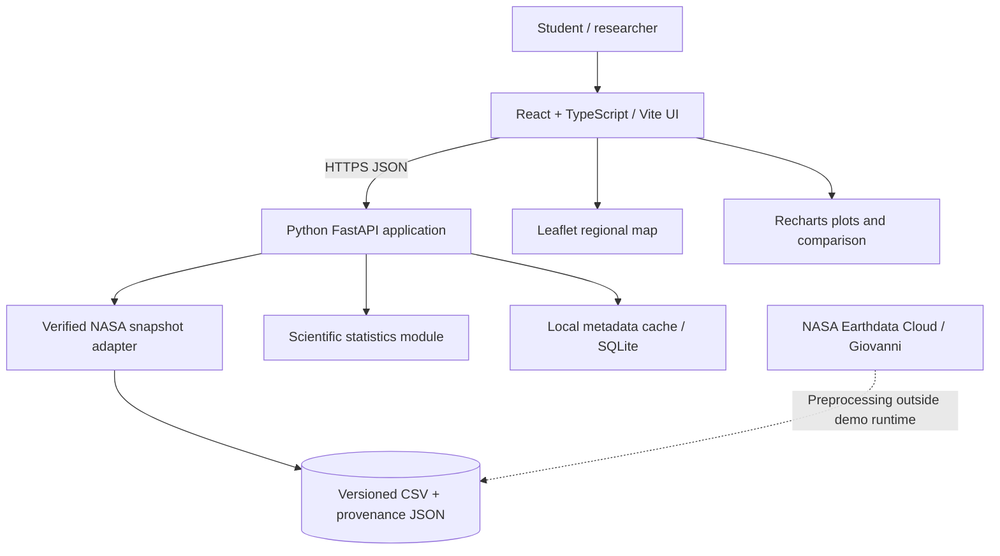

# TerraTrend — Earth Systems Trend Detective

**Industry-style project documentation package | v1.0 | 14 November 2026**  
**Challenge:** NASA Space Apps Challenge 2026 — *Be an Earth Systems Trend Detective!*  
**Team:** Pirathee, Harith, Gaja, Shinthurie, Kavishanth, Aiya (6 members).  
**Status:** Proposed and documented, not implemented. This repository package contains **documentation only**.

## Executive project overview

**TerraTrend** is a web-based scientific investigation application helping students and interested members of the public examine environmental change in authentic NASA Earth observation data. The MVP concentrates on **precipitation** using NASA's GPM IMERG Final monthly product. A user selects a supported region and time range, views monthly rainfall and annual totals, inspects the rate and direction of a trend, and assesses statistical significance with a documented method. Users can compare two locations to see whether patterns differ geographically.

**Primary research question:** *How has annual precipitation changed in the Jaffna area versus the Colombo area over the same complete calendar years, and how strong is the statistical evidence for each trend?*

**Four scientific outputs:** what changed; where; how much (units/year); and whether evidence meets the chosen significance threshold. **A statistically significant association is not proof of a cause** and the app must never make causal claims.

### Scope snapshot

| In the 48-hour MVP (P0) | Only if time allows (P1) | After the hackathon (P2) |
|---|---|---|
| Genuine, versioned NASA precipitation data | Draw a custom bounded rectangle on the map | More datasets: GLDAS, MERRA-2, MODIS |
| Two reproducible regional NASA snapshots | Download PDF report | AI variable suggestions |
| Monthly and annual time-series charts | Refresh from NASA cloud on demand | Pixel-wise significance maps |
| OLS slope, Sen slope + CI, Mann–Kendall p-value | Extra third region | Authentication, collaboration, PostGIS |
| Two-region comparison with separate findings | Docker Compose deployment | Advanced seasonal/autocorrelation modeling |
| Data provenance, caveats, CSV export, validation/tests | Additional explanations | Larger distributed processing |

**Definitions:** P0 = must complete; P1 = optional; P2 = explicitly out of scope. Users may select only variables/regions backed by functioning data. Do not advertise unsupported features as available.

## The six-member ownership map

| Person | Ownership | Scope | Definition of contribution |
|---|---|---|---|
| **Pirathee** | FastAPI backend, API contracts, integration, deployment | Large | Working APIs, integrated demo and production-style error handling |
| **Harith** | NASA dataset acquisition, preprocessing, provenance | Large | Two verifiable, documented real-data regional snapshots |
| **Gaja** | Statistical analysis and scientific validation | Medium | Tested OLS/MK/Sen methods and clear cautions |
| **Shinthurie** | Frontend application and charts | Medium | Working investigator UI and results visualization |
| **Kavishanth** | Geographical selector and region comparison UI | Medium | Two mapped regions and side-by-side comparison view |
| **Aiya** | Test checklist, documentation polish, presentation support | **Small** | Demo checklist, documentation verification, bug reports; no critical-path feature |

See [docs/TEAM_PLAN.md](docs/TEAM_PLAN.md) for exact tasks and dependencies. All five technical owners test the code they submit; Aiya's review supplements, but does not block, engineering ownership.

## Architecture at a glance



**Architecture decision:** one FastAPI service rather than microservices; a complete offline snapshot mode is mandatory so the demo does not rely on live satellite API availability or credentials. No authentication is needed for the non-personal, read-only MVP.

## Proposed repository layout (future source tree)

```text
terratrend/
├── README.md                  # this overview
├── AGENTS.md                  # Warp-recognized project rules
├── WARP.md                    # detailed AI-assisted coding playbook
├── docs/
│   ├── PROJECT_OVERVIEW.md   # executive project charter
│   ├── SRS.md                # formal software requirements specification
│   ├── SCOPE.md              # boundaries, priorities, acceptance
│   ├── ARCHITECTURE.md       # views, workflows, ADRs, data flow
│   ├── TECH_STACK.md         # technology selection and setup
│   ├── TEAM_PLAN.md          # six-member responsibilities
│   ├── API_SPEC.md           # HTTP/JSON API contract
│   ├── SCIENTIFIC_METHOD.md   # scientifically defensible calculations
│   ├── DATA_SOURCES.md       # NASA resources, provenance, access strategy
│   ├── TEST_STRATEGY.md      # test plan and requirements traceability
│   ├── DELIVERY_PLAN.md      # 48-hour schedule, GitHub issues, risks
│   └── RESOURCES.md          # official resources and citations
├── frontend/                  # React + TypeScript app (TT-06/07/08/09) — see frontend/README.md
├── backend/                   # future FastAPI source — NOT created here
├── data/demo/                 # future verified snapshot files — NOT provided here
└── .github/workflows/         # future CI — NOT created here
```

## Core workflow

1. Choose **precipitation**, a **Jaffna-area** or **Colombo-area** preset, and a historical year range (default: **2001–2024**, contingent on data verification).
2. Read real NASA-derived monthly observations from a vetted versioned snapshot; display collection, version, original variable, units, dates, ROI, conversion and retrieval information.
3. Convert original monthly mean rainfall rates (if `mm/hr`) to monthly rainfall totals (`mm`) according to actual month length; retain missing-data warnings.
4. Aggregate **12 valid months** into each annual total, then estimate the change in annual rainfall (`mm/year`) and evaluate evidence for a trend across complete years.
5. Render the chart, fitted line, uncertainty, sample length, p-value, and plain-language interpretation; compare a second region without implying a formal statistical test of *between-region difference*.
6. Export the observational series and provenance as CSV/JSON.

## Proposed start commands (once source code exists)

```bash
# Backend (proposed)
cd backend
python -m venv .venv
source .venv/bin/activate
pip install -r requirements.txt
uvicorn app.main:app --reload

# Frontend (proposed, in a second terminal)
cd frontend
npm ci
npm run dev
```

These commands describe the intended repository after implementation. **No `requirements.txt`, UI, backend application, NASA observations, or active deployments are supplied in this documentation-only package.**

## Success criteria

- At least two verifiable snapshots from the *same* NASA product/version/run and an identical overlapping date window.
- Source metadata and extraction workflow included; no made-up rainfall observations.
- API/UI accepts selected supported regions and successfully returns real time-series data.
- Correct unit conversions, complete-year filtering and statistical outputs with confidence intervals.
- Two-region comparison shows *independent* region-level conclusions.
- Tests pass and demo works while disconnected from NASA services.

## Documentation index

- [Industry-standard project overview](docs/PROJECT_OVERVIEW.md)
- [Full SRS](docs/SRS.md)
- [Scope and non-goals](docs/SCOPE.md)
- [Architecture](docs/ARCHITECTURE.md)
- [Technology stack](docs/TECH_STACK.md)
- [Team responsibilities](docs/TEAM_PLAN.md)
- [API contract](docs/API_SPEC.md)
- [Statistics and methods](docs/SCIENTIFIC_METHOD.md)
- [Data sourcing and reproducibility](docs/DATA_SOURCES.md)
- [Verification and QA](docs/TEST_STRATEGY.md)
- [GitHub issue plan and milestones](docs/DELIVERY_PLAN.md)
- [Official resource links](docs/RESOURCES.md)
- [Warp agent guidance](WARP.md) and [agent rules](AGENTS.md)

## Limitations, ethics and attribution

This is a **student prototype** for a challenge; it is not an official NASA service, a weather forecast, or evidence of the causes of environmental changes. Satellite-derived estimates contain uncertainty, and monthly/annual aggregation can hide important variation. NASA data products and any map tiles must be attributed appropriately. Do not expose Earthdata credentials or API secrets. **Do not present illustrative UI figures as measured data.**
