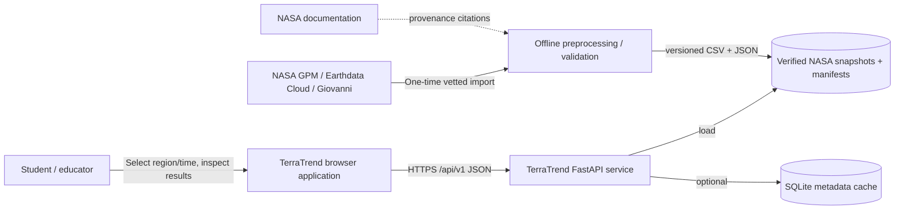
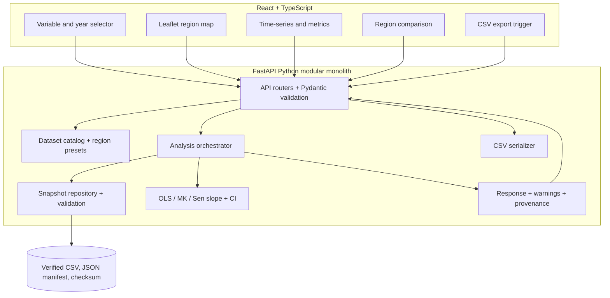
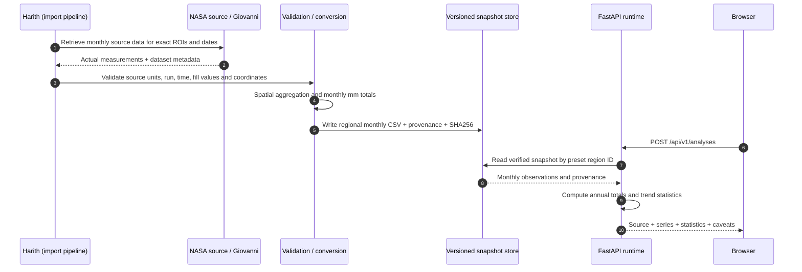
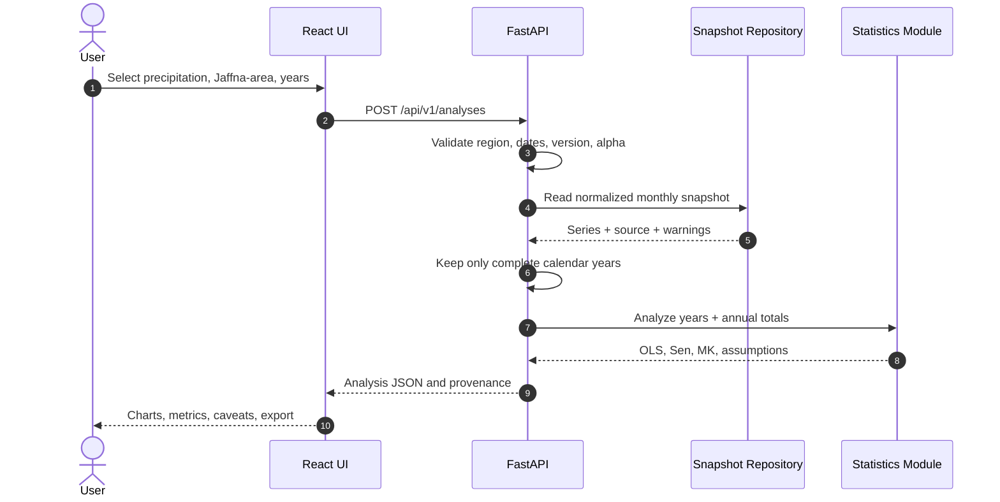
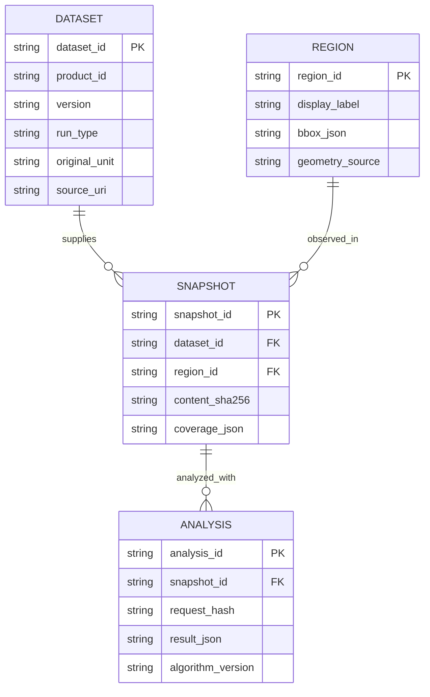

# Solution architecture and design decisions

**Architecture v1.0 | Proposed | Intended for 48-hour MVP**  
**Style:** modular monolith, separately deployed SPA frontend and FastAPI backend, immutable research-data snapshots.

## 1. Context and quality drivers

**Primary quality drivers:** scientific correctness, reproducibility, low developer coordination cost, clear source attribution, availability during demos and maintainable interfaces. Complex authentication, distributed services and real-time analytics do not contribute enough value to the P0 challenge outcome.

### Context diagram



The NASA source is external; the student app is **not a NASA-approved or NASA-hosted product**.

## 2. Logical containers



### Responsibility boundaries

- **Harith / data adapter:** data collection, region aggregation, rate-to-total transformation, quality flags, immutable manifest.
- **Gaja / statistics:** pure functions taking complete annual year/total arrays; stateless, deterministic output and warnings.
- **Pirathee / backend:** request validation, API orchestration, exports, errors, integration and infrastructure.
- **Shinthurie / frontend:** top-level UX, state management, charts, source/warning display.
- **Kavishanth / geo:** map preset bounds and comparison interface; no scientific calculations in TypeScript.
- **Aiya:** documentation and test walkthroughs (smaller workstream).

## 3. Data ingestion pipeline (offline P0)



**Critical boundary:** A pre-extracted *regional time-series* (e.g., Giovanni export) and a raw *gridded monthly rate product* require different transformations. Never apply both geospatial aggregation and rate conversion twice. Manifest defines precisely what its snapshot values represent.

### Proposed snapshot manifest shape

```json
{
  "snapshot_id": "gpm-imergm-v07b-demo-2001-2024-v1",
  "collection_id": "GPM_3IMERGM_07",
  "version_label": "V07B",
  "run_type": "Final",
  "variable_source_name": "verify-from-netcdf-or-source-metadata",
  "original_unit": "verify-from-file",
  "snapshot_unit": "mm/month",
  "period": {"start": "2001-01", "end": "2024-12"},
  "spatial_method": "verified area-weighted mean, not assumed",
  "regions": ["jaffna_area", "colombo_area"],
  "retrieved_at": null,
  "source_uri": "https://gpm.nasa.gov/data/directory",
  "input_sha256": "REPLACE_WITH_REAL_CHECKSUM",
  "output_sha256": "REPLACE_WITH_REAL_CHECKSUM",
  "transform_script_version": "proposed-v1",
  "quality_summary": "populate after validation"
}
```

This JSON is a **schema illustration**, not a completed provenance manifest. Any placeholder must be replaced with verified values or the dataset is not release-ready.

## 4. Request execution sequence



## 5. Storage strategy

**MVP:** small versioned local CSV/JSON snapshots and an in-memory analysis result store. SQLite optional when keeping result IDs beyond a single process lifetime; **not required** to demonstrate the challenge. Snapshot datasets should be immutable and identified by checksum. Do not keep NASA credentials in the SQLite file. Original download may stay outside Git if too large, but must be fetchable with a documented process.

### Optional persistence model



## 6. Error and fault tolerance design

| Failure | HTTP/code | UI behavior | P0 fallback |
|---|---|---|---|
| Invalid region or impossible year range | 422 `INVALID_ARGUMENT` | Explain supported input | User adjusts selection |
| Snapshot unavailable | 503 `DATASET_UNAVAILABLE` | Show unavailability and provenance status | Disallow false results |
| No complete years / short series | 422 `INSUFFICIENT_DATA` | Explain missing years | Select longer period |
| Incompatible regions' source metadata | 409 `INCOMPATIBLE_DATA` | Block misleading comparison | Re-import comparable snapshots |
| Internal statistics exception | 500 `ANALYSIS_ERROR` | Human-readable generic error + request ID | No fabricated fallback |
| NASA cloud temporarily down | Optional 503 `UPSTREAM_UNAVAILABLE` | Explain status | Read already verified P0 snapshot |

Never catch a scientific error and replace it with example or random data.

## 7. Security and threat model

| Asset | Risk | Control |
|---|---|---|
| Earthdata credentials (P1) | Token leak into Git/browser | Server-only configuration and `.env` exclusion, secret scanning |
| Scientific results | Misleading figures due to unit/version mixing | Provenance/checksum checks, version locks, testing |
| API | Excessive requests, malicious parameters | Restrict input to known presets and bounded periods, rate limits if public |
| Browser | XSS via display labels | React-safe text rendering, content security policy where deployed |
| Map tiles | Unauthorized use or missing attribution | Respect tile provider terms; visible attribution |
| Dependencies | Supply-chain vulnerabilities | Version pins/lockfiles, dependency auditing |
| Logs | Sensitive values and unstable debugging | Log IDs/timings/status; redact secrets and user-provided tokens |

The P0 app has no password system and no user-upload feature, substantially reducing privacy and security risk. Use HTTPS for a public deployment, restrictive CORS and environment-specific settings.

## 8. Architecture decisions (ADRs)

### ADR-001: FastAPI monolith (accepted for MVP)
**Decision:** one Python backend, not Spring Boot + Python service mesh. **Reason:** statistical libraries and data processing integrate naturally; fewer deployment/dependency handoffs in 48 hours. **Tradeoff:** backend is Python rather than Java; Java integration can follow later if useful.

### ADR-002: Preverified NASA snapshots first (accepted)
**Decision:** P0 analysis reads prepared, authentic, versioned local snapshots. **Reason:** Earthdata account/data transfer can be slow/unreliable in a live demo. **Tradeoff:** arbitrary regions and live data freshness are deferred.

### ADR-003: One primary variable (accepted)
**Decision:** precipitation is functional; optional catalogue hints for other variables must be disabled. **Reason:** deep reliability and clear statistical conclusions beat superficial integrations.

### ADR-004: Independent annual-trend inference (accepted)
**Decision:** evaluate complete annual rainfall totals using OLS, Sen slope/CI, and MK. **Reason:** reduces monthly seasonality confusion; compute/sample-year assumptions remain visible. **Tradeoff:** does not characterize within-year seasonal trends or establish causation.

### ADR-005: Two fixed regional presets first (accepted)
**Decision:** show Jaffna-area and Colombo-area verified bounding boxes. **Reason:** ensures actual data exist and comparability is reviewable. **Tradeoff:** arbitrary ROI drawing is P1, city areas are not administrative districts.

## 9. Performance, deployment and operability

- Cache preprocessed series by dataset checksum + region + dates. Cache invalidation requires new manifest hash.
- The source preprocessing may be run offline manually; web request must **not** download many global granules synchronously.
- P0 deployment: one static frontend and one FastAPI service with bundled verified snapshots. Use environment variables for base URL/CORS; no secrets required for offline demo.
- `GET /health` exposes liveness but not secret configuration or scientific state; use an additional readiness check if needed.
- CI should type/lint/test and verify manifest shape; deployment steps recorded in `TECH_STACK.md`.

## 10. Evolution path (P2)

Introduce full ROI processing with NetCDF/Zarr + Xarray, dataset discovery via NASA CMR/Earthaccess, PostGIS and object storage if usage grows, more environmental variables, proper seasonal/autocorrelation-aware inference, downloadable reports and scientific peer review. Do not start those additions before the P0 release gate.
