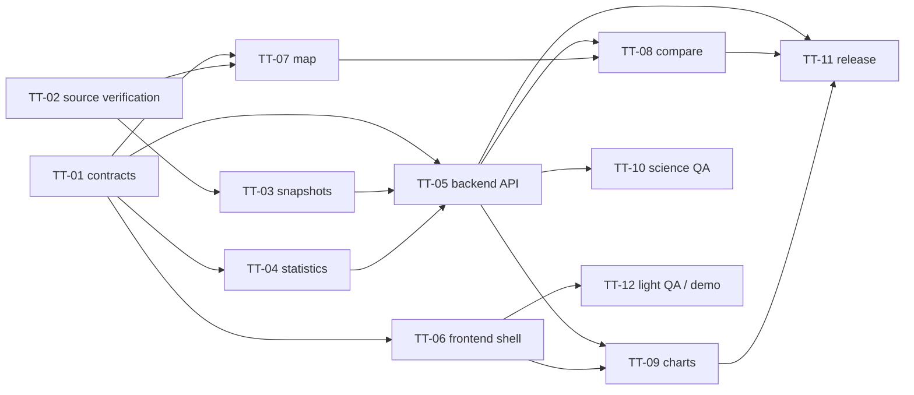

# Delivery plan, GitHub issue backlog, dependencies and risk register

**Planning horizon:** 48-hour intensive hackathon development. **Status:** Proposed backlog; no GitHub issues or code have been created by this document.

## 1. Release milestones

| Time | Milestone | Non-negotiable evidence |
|---|---|---|
| H0–H6 | Contracts + data viability | Source pathway, stable API schema, verified scope |
| H6–H16 | First authentic observation | Single region's real NASA monthly series + provenance |
| H16–H24 | One complete science loop | One-region chart, annual trend and valid statistical interpretation |
| H24–H32 | Two-region scientific compare | Comparable data, mapped presets, independent findings |
| H32–H40 | Integration and quality | Tests, exports, offline demo, source/method audit |
| H40–H48 | Freeze / demo / release | Stable build, README, walkthrough, no new feature scope |

**Kill-switch rule:** if live NASA data access is unreliable by H6, prioritize valid Giovanni export/manual Earthdata download. Do **not** substitute synthetic observations; escalate source blocker and disclose it.

## 2. Proposed GitHub issue backlog (create in this order of dependency, parallel where possible)

### TT-01 — Repo bootstrap and OpenAPI schema (Pirathee)
**Priority:** P0; **Dependencies:** None.  
**Description:** Initialize (later) backend/frontend repo, enforce strict formatting/test scripts, define Pydantic request/response schemas, structured error format and region/variable interfaces. Document local development commands.  
**Acceptance:** Test/lint scripts work on fresh clone; mock schema fixtures contain no fake *NASA* claims; API spec aligns with `API_SPEC.md`; CI skeleton ready.  
**Deliverables:** `backend/`, `frontend/`, GitHub workflow, `README` updates.

### TT-02 — Verify NASA product and extraction method (Harith)
**Priority:** P0; **Dependencies:** None.  
**Description:** Identify actual IMERG monthly Final product, run and version; check collection visibility and timestamps, original file units, Earthdata/Giovanni access and two sensible city-area bboxes.  
**Acceptance:** Source URLs, fields, unit metadata, exact ROI and date coverage documented; distinguish pre-aggregated time series from raw grids.  
**Deliverables:** data source decision and source evidence.

### TT-03 — Real regional snapshot generation (Harith)
**Priority:** P0; **Dependencies:** TT-02.  
**Description:** Extract Jaffna-area and Colombo-area monthly series from same NASA source. Convert rates only when appropriate, report coverage, save immutable versioned CSV + manifest + hashes.  
**Acceptance:** No synthetic observation in release, identical source/version/run/period/spatial method, reproducibility and completeness checks pass.  
**Deliverables:** `data/demo/...`, validation tests/scripts.

### TT-04 — Scientific trend engine and reference tests (Gaja)
**Priority:** P0; **Dependencies:** TT-01 (schema).  
**Description:** Implement annual-complete-year calculation, OLS slope, Sen slope + CI, Mann–Kendall p-value, checks on constant/short/serially dependent series.  
**Acceptance:** Known synthetic reference cases pass, outputs include method, assumptions warnings, actual years, `mm/year` slope and no causation assertions.  
**Deliverables:** pure `backend/app/statistics/` package and tests.

### TT-05 — Integrate analysis, compare and export HTTP APIs (Pirathee)
**Priority:** P0; **Dependencies:** TT-01, TT-03, TT-04.  
**Description:** Read snapshots, validate region/date/metadata, call science engine, expose source-rich single/compare results, export CSV and structured errors.  
**Acceptance:** OpenAPI contract and integration tests pass; two real regions served; NASA-offline analysis works.  
**Deliverables:** FastAPI routers/services and tests.

### TT-06 — Investigator frontend shell + core dashboard (Shinthurie)
**Priority:** P0; **Dependencies:** TT-01 schema, can use typed local *clearly marked fixtures* temporarily.  
**Description:** Responsive React layout, one active variable, date selection, run button, status and provenance display; connect real API before release.  
**Acceptance:** API error/loading/empty/ready states; no hardcoded findings in final build.  
**Deliverables:** `frontend/src/features/investigate`.

### TT-07 — Interactive map and verified preset selector (Kavishanth)
**Priority:** P0; **Dependencies:** TT-01 region schema; verified bbox from TT-02 before finish.  
**Description:** Leaflet component with actual verified preset rectangles and descriptive labels.  
**Acceptance:** Map extents exactly match backend/manifest; tile attribution; no district mislabeling.  
**Deliverables:** `frontend/src/features/regions`.

### TT-08 — Regional comparison interface (Kavishanth)
**Priority:** P0; **Dependencies:** TT-05, TT-07; Shinthurie's shared chart styles.  
**Description:** Pair selectable preset regions and render independently calculated trends for common study period.  
**Acceptance:** Two true charts/statistics, shared data version/run/years, no claim that slope difference was formally significance-tested.  
**Deliverables:** `frontend/src/features/compare`.

### TT-09 — Time-series charts, findings and export controls (Shinthurie)
**Priority:** P0; **Dependencies:** TT-05, TT-06.  
**Description:** Monthly totals chart, annual totals + OLS line, trend cards, 95% CI, caveats and CSV download.  
**Acceptance:** Chart numbers match backend, units and provenance visible, loading/error states clear, CSV works.  
**Deliverables:** charts/results/export UX.

### TT-10 — Scientific data and interface audit (Harith + Gaja)
**Priority:** P0; **Dependencies:** TT-03, TT-04, TT-05.  
**Description:** Cross-check actual NASA source/monthly conversion, yearly aggregation, statistical output, missing/coverage/assumption flags.  
**Acceptance:** Source-to-result spot checks independently reproduced; report caveats; no science-critical defect.  
**Deliverables:** science verification checklist/results.

### TT-11 — CI, integration smoke, deployment and release (Pirathee)
**Priority:** P0; **Dependencies:** TT-05, TT-08, TT-09.  
**Description:** Run backend/FE tests, build deployment, verify offline demo, CORS/secrets, API error behavior and README commands.  
**Acceptance:** Demo path works without NASA network; no secrets committed; release tag identifies snapshot/model versions.  
**Deliverables:** CI/config, deployment URL if created, release checklist.

### TT-12 — Manual QA + docs + demo script (Aiya — SMALL)
**Priority:** P0 supporting; **Dependencies:** any working UI for screenshots.  
**Description:** Light QA guided by `TEST_STRATEGY.md`, review labels/links/caveats, log bugs, coordinate short demo script. No critical algorithm/API ownership.  
**Acceptance:** Completed manual QA checklist and short verified demo steps; bugs assigned to module owners.  
**Deliverables:** `docs/demo-checklist.md` and issue reports after implementation.

## 3. Dependency chart

`TT-12` supports quality but does not hold core backend tasks on the critical path. If Aiya is unavailable, each feature owner can conduct its own smoke tests.

## 4. Risk register

| Risk | Likelihood | Impact | Mitigation | Owner |
|---|---|---|---|---|
| Earthdata login / old server endpoints break | Medium | Critical | Verify cloud access early; use versioned Giovanni/Earthdata snapshots | Harith |
| V07/V08 version mixing | Medium | High | Freeze product/run/version; compare manifests | Harith + Gaja |
| Mean rate `mm/hr` mistaken for total `mm` | Medium | Critical | Inspect units; unit tests; science review | Harith |
| Missing months bias annual trends | Medium | High | Require 12 valid months, exclude and report | Harith + Gaja |
| Autocorrelation leads to overconfident p-values | Medium | High | Diagnostics, warnings, `indeterminate` unless defensible | Gaja |
| Too broad scope (extra datasets/AI) | High | High | P0-only freeze, track P1/P2 separately | Pirathee |
| Frontend/backend schema drift | Medium | High | Contract-first API, sample fixtures, review changes | Pirathee + Shinthurie |
| Maps show wrong admin boundary | Medium | Medium | Label as areas near cities, verify exact bbox | Kavishanth |
| Public demo fails due to NASA outages | Medium | High | Verified local snapshots and offline smoke test | Pirathee |
| Credentials / source files leaked | Low | High | Secrets scanning and `.gitignore`; no browser tokens | Pirathee |
| Unverified numerical result presented | Medium | Critical | Real-data provenance, science audit and demo script | Gaja + Harith |

## 5. Suggested PR / review policy

- Branch pattern `feat/tt-03-nasa-snapshots`, `fix/tt-04-sen-ci`, etc.
- Every PR includes issue ID, `FR-/NFR-` references, changed files, tests actually run and data/provenance impact.
- Pirathee reviews cross-module API changes. Harith must approve source format/version changes. Gaja must review significance algorithms/interpretations. UI owner reviews visual components.
- Freeze scope/features at H40. Resolve release-blocking defects only; publish limitations clearly if necessary.

## 6. Demo runbook (60–120 seconds)

1. **Intro:** "TerraTrend helps investigate how rainfall has changed, where, by how much and with what statistical evidence."
2. **Source:** show real NASA GPM IMERG dataset ID, Final run, version, period and verified region.
3. **Investigate:** select Jaffna-area; display monthly/annual historical charts and actual trend estimates.
4. **Interpret:** explain Sen slope in `mm/year`, MK p-value, 95% CI and sample years; point out limitations.
5. **Compare:** switch to Jaffna versus Colombo and show independent trends, same product and comparable time span.
6. **Export:** download CSV and describe source provenance.
7. **Close:** demonstrate real data + science workflow, not prediction and not causal proof.

Do **not** read invented headline statistics. Use the numbers produced by verified data or state that source import is incomplete.
