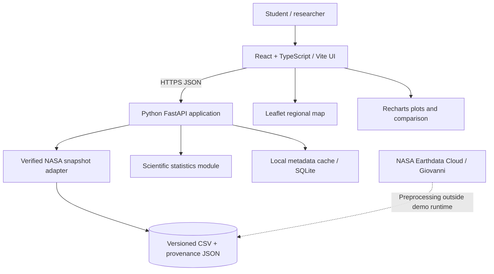
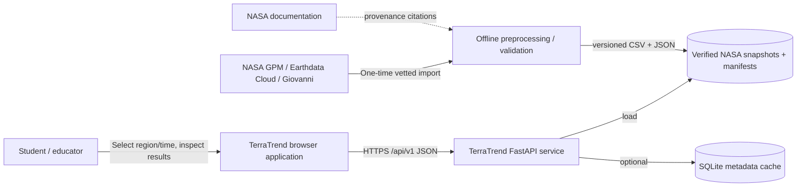
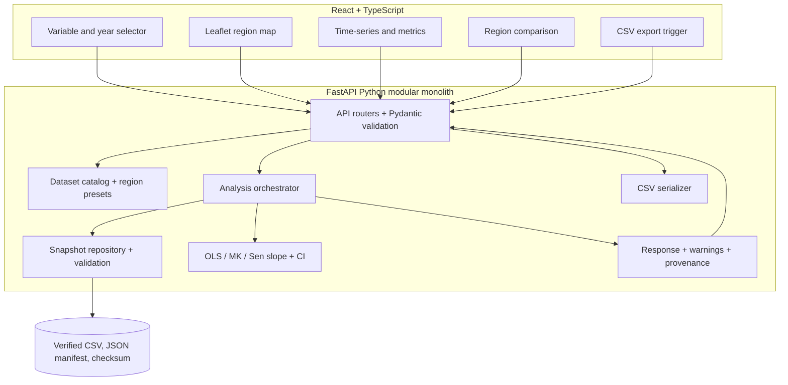
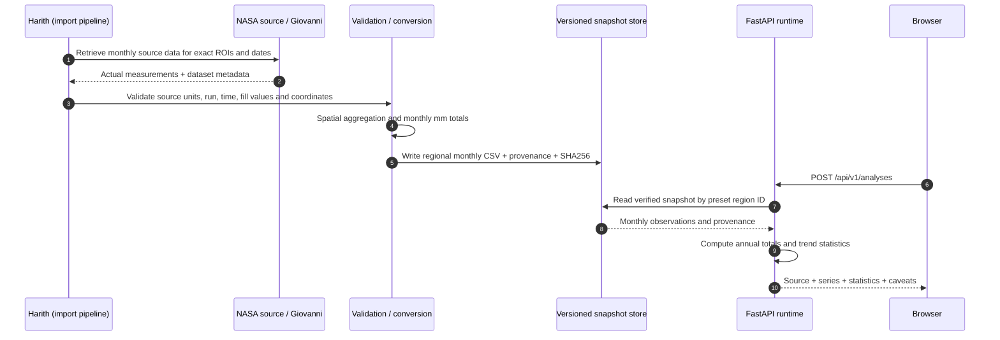
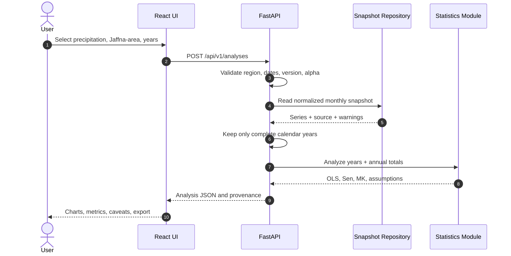
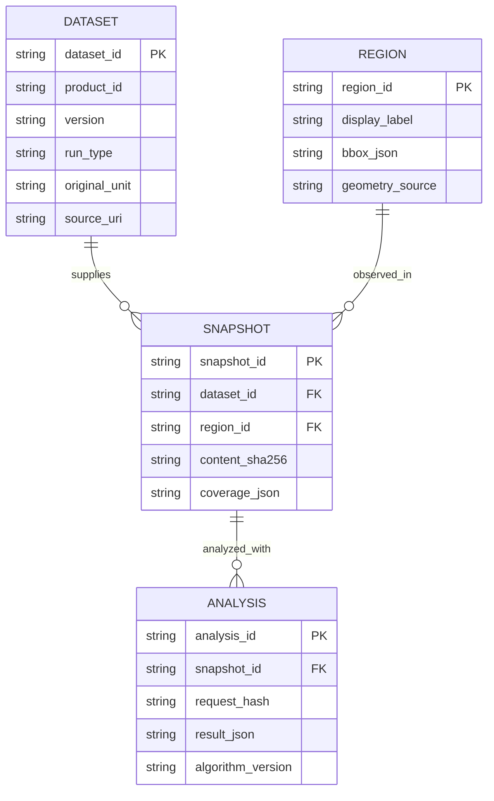
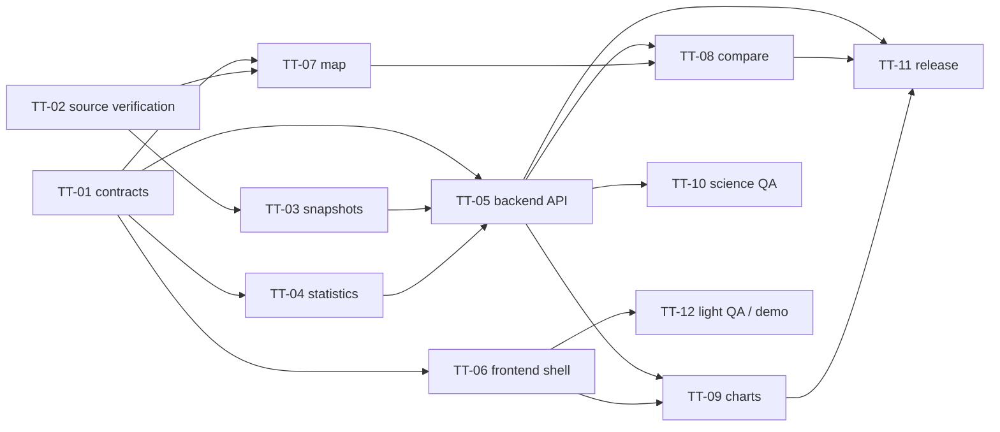

# TerraTrend — Complete Documentation (Consolidated)

> This consolidated document is an easy-to-read copy. The ZIP keeps the original separately editable Markdown files.

## Contents

1. `README.md`
2. `docs/PROJECT_OVERVIEW.md`
3. `docs/SRS.md`
4. `docs/SCOPE.md`
5. `docs/ARCHITECTURE.md`
6. `docs/TECH_STACK.md`
7. `docs/TEAM_PLAN.md`
8. `docs/API_SPEC.md`
9. `docs/SCIENTIFIC_METHOD.md`
10. `docs/DATA_SOURCES.md`
11. `docs/TEST_STRATEGY.md`
12. `docs/DELIVERY_PLAN.md`
13. `docs/RESOURCES.md`
14. `WARP.md`
15. `AGENTS.md`


---

<!-- Source: README.md -->

# TerraTrend — Earth Systems Trend Detective

**Industry-style project documentation package | v1.0 | 14 November 2026**  
**Challenge:** NASA Space Apps Challenge 2026 — *Be an Earth Systems Trend Detective!*  
**Team:** Pirathee, Harith, Gaja, Shinthurie, Kavishanth, Aiya (6 members).  
**Status:** Proposed and documented, not implemented. This repository package contains **documentation only**.

## Executive project overview

**TerraTrend** is a web-based scientific investigation application helping students and interested members of the public examine environmental change in authentic NASA Earth observation data. The MVP concentrates on **precipitation** using NASA's GPM IMERG Final monthly product. A user selects a supported region and time range, views monthly rainfall and annual totals, inspects the rate and direction of a trend, and assesses statistical significance with a documented method. Users can compare two locations to see whether patterns differ geographically.

**Primary research question:** *How has annual precipitation changed in the Jaffna area versus the Colombo area over the same complete calendar years, and how strong is the statistical evidence for each trend?*

**Four scientific outputs:** what changed; where; how much (units/year); and whether evidence meets the chosen significance threshold. **A statistically significant association is not proof of a cause** and the app must never make causal claims.

### Scope snapshot

| In the 48-hour MVP (P0) | Only if time allows (P1) | After the hackathon (P2) |
|---|---|---|
| Genuine, versioned NASA precipitation data | Draw a custom bounded rectangle on the map | More datasets: GLDAS, MERRA-2, MODIS |
| Two reproducible regional NASA snapshots | Download PDF report | AI variable suggestions |
| Monthly and annual time-series charts | Refresh from NASA cloud on demand | Pixel-wise significance maps |
| OLS slope, Sen slope + CI, Mann–Kendall p-value | Extra third region | Authentication, collaboration, PostGIS |
| Two-region comparison with separate findings | Docker Compose deployment | Advanced seasonal/autocorrelation modeling |
| Data provenance, caveats, CSV export, validation/tests | Additional explanations | Larger distributed processing |

**Definitions:** P0 = must complete; P1 = optional; P2 = explicitly out of scope. Users may select only variables/regions backed by functioning data. Do not advertise unsupported features as available.

## The six-member ownership map

| Person | Ownership | Scope | Definition of contribution |
|---|---|---|---|
| **Pirathee** | FastAPI backend, API contracts, integration, deployment | Large | Working APIs, integrated demo and production-style error handling |
| **Harith** | NASA dataset acquisition, preprocessing, provenance | Large | Two verifiable, documented real-data regional snapshots |
| **Gaja** | Statistical analysis and scientific validation | Medium | Tested OLS/MK/Sen methods and clear cautions |
| **Shinthurie** | Frontend application and charts | Medium | Working investigator UI and results visualization |
| **Kavishanth** | Geographical selector and region comparison UI | Medium | Two mapped regions and side-by-side comparison view |
| **Aiya** | Test checklist, documentation polish, presentation support | **Small** | Demo checklist, documentation verification, bug reports; no critical-path feature |

See [docs/TEAM_PLAN.md](docs/TEAM_PLAN.md) for exact tasks and dependencies. All five technical owners test the code they submit; Aiya's review supplements, but does not block, engineering ownership.

## Architecture at a glance



**Architecture decision:** one FastAPI service rather than microservices; a complete offline snapshot mode is mandatory so the demo does not rely on live satellite API availability or credentials. No authentication is needed for the non-personal, read-only MVP.

## Proposed repository layout (future source tree)

```text
terratrend/
├── README.md                  # this overview
├── AGENTS.md                  # Warp-recognized project rules
├── WARP.md                    # detailed AI-assisted coding playbook
├── docs/
│   ├── PROJECT_OVERVIEW.md   # executive project charter
│   ├── SRS.md                # formal software requirements specification
│   ├── SCOPE.md              # boundaries, priorities, acceptance
│   ├── ARCHITECTURE.md       # views, workflows, ADRs, data flow
│   ├── TECH_STACK.md         # technology selection and setup
│   ├── TEAM_PLAN.md          # six-member responsibilities
│   ├── API_SPEC.md           # HTTP/JSON API contract
│   ├── SCIENTIFIC_METHOD.md   # scientifically defensible calculations
│   ├── DATA_SOURCES.md       # NASA resources, provenance, access strategy
│   ├── TEST_STRATEGY.md      # test plan and requirements traceability
│   ├── DELIVERY_PLAN.md      # 48-hour schedule, GitHub issues, risks
│   └── RESOURCES.md          # official resources and citations
├── frontend/                  # future React application — NOT created here
├── backend/                   # future FastAPI source — NOT created here
├── data/demo/                 # future verified snapshot files — NOT provided here
└── .github/workflows/         # future CI — NOT created here
```

## Core workflow

1. Choose **precipitation**, a **Jaffna-area** or **Colombo-area** preset, and a historical year range (default: **2001–2024**, contingent on data verification).
2. Read real NASA-derived monthly observations from a vetted versioned snapshot; display collection, version, original variable, units, dates, ROI, conversion and retrieval information.
3. Convert original monthly mean rainfall rates (if `mm/hr`) to monthly rainfall totals (`mm`) according to actual month length; retain missing-data warnings.
4. Aggregate **12 valid months** into each annual total, then estimate the change in annual rainfall (`mm/year`) and evaluate evidence for a trend across complete years.
5. Render the chart, fitted line, uncertainty, sample length, p-value, and plain-language interpretation; compare a second region without implying a formal statistical test of *between-region difference*.
6. Export the observational series and provenance as CSV/JSON.

## Proposed start commands (once source code exists)

```bash
# Backend (proposed)
cd backend
python -m venv .venv
source .venv/bin/activate
pip install -r requirements.txt
uvicorn app.main:app --reload

# Frontend (proposed, in a second terminal)
cd frontend
npm ci
npm run dev
```

These commands describe the intended repository after implementation. **No `requirements.txt`, UI, backend application, NASA observations, or active deployments are supplied in this documentation-only package.**

## Success criteria

- At least two verifiable snapshots from the *same* NASA product/version/run and an identical overlapping date window.
- Source metadata and extraction workflow included; no made-up rainfall observations.
- API/UI accepts selected supported regions and successfully returns real time-series data.
- Correct unit conversions, complete-year filtering and statistical outputs with confidence intervals.
- Two-region comparison shows *independent* region-level conclusions.
- Tests pass and demo works while disconnected from NASA services.

## Documentation index

- [Industry-standard project overview](docs/PROJECT_OVERVIEW.md)
- [Full SRS](docs/SRS.md)
- [Scope and non-goals](docs/SCOPE.md)
- [Architecture](docs/ARCHITECTURE.md)
- [Technology stack](docs/TECH_STACK.md)
- [Team responsibilities](docs/TEAM_PLAN.md)
- [API contract](docs/API_SPEC.md)
- [Statistics and methods](docs/SCIENTIFIC_METHOD.md)
- [Data sourcing and reproducibility](docs/DATA_SOURCES.md)
- [Verification and QA](docs/TEST_STRATEGY.md)
- [GitHub issue plan and milestones](docs/DELIVERY_PLAN.md)
- [Official resource links](docs/RESOURCES.md)
- [Warp agent guidance](WARP.md) and [agent rules](AGENTS.md)

## Limitations, ethics and attribution

This is a **student prototype** for a challenge; it is not an official NASA service, a weather forecast, or evidence of the causes of environmental changes. Satellite-derived estimates contain uncertainty, and monthly/annual aggregation can hide important variation. NASA data products and any map tiles must be attributed appropriately. Do not expose Earthdata credentials or API secrets. **Do not present illustrative UI figures as measured data.**


---

<!-- Source: docs/PROJECT_OVERVIEW.md -->

# Project Overview — TerraTrend

**Project ID:** TT-NASA-2026 | **Status:** Design baseline, not yet built | **Revision:** 1.0 (14 November 2026)  
**Team:** Pirathee, Harith, Gaja, Shinthurie, Kavishanth, Aiya  
**Category:** Earth science visualization / statistical analytics | **Delivery:** 48-hour hackathon MVP

## Executive summary

TerraTrend is an interactive NASA Earth-observation trend explorer for learners and investigators. It combines an authentic, clearly attributed historical satellite dataset with time-series charts, geographic context and a justified trend significance calculation. Users select a supported area and analysis period and receive four interpretable findings: **what changes, where it changes, how much it changes and whether the trend is statistically significant** under stated assumptions.

The initial release deliberately narrows to **precipitation only**, using verified monthly records from the NASA GPM IMERG Final collection for two areas near Jaffna and Colombo. Both regional time series must use the same product version/run, a consistent aggregation method and a common complete-year analysis range. This focused scope gives the team enough time to validate the science instead of building a superficial all-variable dashboard.

## Problem, solution and value

| Dimension | Description |
|---|---|
| Problem | Earth observation trends require dataset selection, geospatial extraction, correct units, missing-data handling and statistical analysis. Students may mistake visual slopes for statistically supported trends. |
| Solution | One guided web workflow with authentic NASA data, verified regions, charts, OLS/Sen trend magnitude, Mann–Kendall inference, confidence intervals and plain-English cautions. |
| Primary user | High-school and university student investigating long-term environmental changes. |
| Secondary user | Educator, evaluator or citizen scientist wanting reproducible exploratory findings. |
| Differentiator | Built-in **source provenance + significance testing + two-region comparison**, not merely a static climate chart. |
| Research example | Compare the direction and magnitude of annual rainfall trends for a Jaffna-area and Colombo-area bounding box over verified complete calendar years. |
| Delivery principle | Small, reliable, offline-capable MVP with documented boundaries. |

## Goals and measurable outcomes

- **G1 — Reproducible data:** two NASA-derived snapshots with exact product ID, version, dates, ROI, units and SHA-256 hashes.
- **G2 — Correct analytics:** robust month/annual processing, OLS and Sen slope, 95% interval, and MK significance with explicit assumptions; reference tests pass.
- **G3 — Usable investigation:** user selects a supported region, reads monthly/annual chart and interpretation, downloads data.
- **G4 — Geographic comparison:** selected Jaffna and Colombo areas shown on map; paired analysis covers comparable years and independent results.
- **G5 — Reliable demo:** primary investigation and comparison work using local verified snapshots even when external NASA servers cannot be reached.
- **G6 — Responsible claims:** no measured value fabricated, no unsupported causal conclusion, no NASA endorsement asserted.

## Major deliverables

| ID | Output | Evidence |
|---|---|---|
| D-01 | SRS and API contracts | `SRS.md`, `API_SPEC.md` reviewed |
| D-02 | Verified NASA data pipeline | Two real snapshots + manifests after implementation |
| D-03 | Statistical service | Tested OLS / Sen / MK functions |
| D-04 | Web dashboard and regional map | Working UI backed by actual API |
| D-05 | Comparison and CSV export | Reproducible side-by-side results |
| D-06 | Test and presentation evidence | QA report and offline demo |

## Architecture summary

**React + TypeScript (frontend)** → **FastAPI/Python (API & statistics)** → **verified monthly NASA data snapshots + provenance JSON**. Leaflet maps show selected rectangles; Recharts renders the time series. Harith imports/validates satellite data, Gaja implements statistical inference, Pirathee integrates the services, Shinthurie builds the dashboard, Kavishanth builds the map/compare UI, and Aiya contributes a **small** QA/documentation/demo workstream.

## Business and scientific boundaries

This software is **exploratory educational analysis**, not a forecasting system, hazard alert, administrative-district precipitation report, climate-causation engine or official NASA product. Statistical significance alone does not establish practical significance or explain causes. Live data fetching, more variables and AI suggestions are future items.

## Key risks and safeguards

NASA Earthdata service migration/version changes → immutable snapshot manifest and verified access route. Data units or spatial aggregation mistakes → independent data validation and unit tests. Seasonal patterns and serial dependence → complete annual totals and clear inference warnings. Hackathon schedule → features gated by P0/P1/P2 and no extra architecture complexity.

## Document navigation

- Functional and quality requirements: [SRS](SRS.md)
- Scope and exclusions: [SCOPE](SCOPE.md)
- Architecture decisions/diagrams: [ARCHITECTURE](ARCHITECTURE.md)
- Technology selection: [TECH_STACK](TECH_STACK.md)
- Data access and citations: [DATA_SOURCES](DATA_SOURCES.md), [RESOURCES](RESOURCES.md)
- Six-member module plan: [TEAM_PLAN](TEAM_PLAN.md)
- API contracts: [API_SPEC](API_SPEC.md)
- Scientific methods: [SCIENTIFIC_METHOD](SCIENTIFIC_METHOD.md)
- Quality gates and GitHub issues: [TEST_STRATEGY](TEST_STRATEGY.md), [DELIVERY_PLAN](DELIVERY_PLAN.md)


---

<!-- Source: docs/SRS.md -->

# Software Requirements Specification (SRS)

**Project:** TerraTrend — Earth Systems Trend Detective  
**Version:** 1.0 | **Status:** Proposed/baselined for build | **Date:** 2026-11-14  
**Requirements approach:** IEEE/ISO/IEC 29148-inspired structure; adapted to a short NASA Space Apps Challenge implementation. This is **not an IEEE certification**.  
**Product owner / integrator:** Pirathee | **Scientific reviewers:** Harith and Gaja  
**Related:** [Scope](SCOPE.md), [Architecture](ARCHITECTURE.md), [API](API_SPEC.md), [Science](SCIENTIFIC_METHOD.md), [Verification](TEST_STRATEGY.md).

## 1. Introduction

### 1.1 Purpose
Specify a consistent, testable set of functional and nonfunctional requirements for a browser-based Earth-science trend investigation application. The software helps users discover, display and evaluate regional changes in authentic satellite-derived environmental observations.

### 1.2 Problem statement
Scientific datasets have many variables, different spatial and temporal resolutions, seasonal patterns and missing values. Without an integrated workflow, a learner may incorrectly infer a trend from a plot or misread a significance test. The product must provide verified time-series data, clear units, trend magnitude, significance and limitations for a region.

### 1.3 Vision and scope
The *general vision* is a flexible Earth-science trend explorer. The **release v1.0 MVP** implements only **GPM IMERG Final monthly precipitation** for two supported region presets, with a reproducible offline data source. A two-region comparison is included. No AI model is required. `SCOPE.md` controls mandatory versus stretch priorities.

### 1.4 Intended audience and stakeholders
- **Primary users:** high-school / university learners, hackathon judges, scientifically curious public.
- **Secondary users:** educators and students practicing remote sensing and statistics.
- **Build stakeholders:** Pirathee (integration), Harith (data), Gaja (science), Shinthurie (UI), Kavishanth (maps), Aiya (light QA/docs).
- **External stakeholders:** NASA data providers as cited sources, not as sponsors or approving entities.

### 1.5 Definitions
| Term | Meaning |
|---|---|
| Variable | Scientific measure being investigated; for MVP, precipitation |
| ROI | Region of interest, here a supported geographic bounding box |
| BBox | `[west, south, east, north]` in WGS84 longitude/latitude degrees |
| IMERG | NASA's Integrated Multi-satellitE Retrievals for GPM |
| Time series | Observations aggregated and ordered over historical time |
| OLS | Ordinary least squares linear regression |
| MK | Mann–Kendall nonparametric trend significance test |
| Sen/Theil–Sen | Median of pairwise slopes, with confidence limits when supported |
| p-value | Measure of evidence against a specified no-trend null hypothesis, under model/test assumptions |
| alpha | Chosen decision threshold, default 0.05 |
| Complete year | Calendar year with 12 valid monthly totals for the selected region |
| Snapshot | Real NASA-derived, locally stored dataset with reproducible provenance |
| P0/P1/P2 | Mandatory / optional / deferred scope classes |

### 1.6 References
See [RESOURCES.md](RESOURCES.md). The original supplied NASA challenge description supplies the four objectives: identify variables; retrieve regional data; show long time series; statistically evaluate rate/significance. This SRS refines that challenge into a feasible hackathon scope.

## 2. Overall system description

### 2.1 Product perspective
Single-page browser app calling a stateless HTTP JSON service. Backend loads an authenticated/prepared, versioned NASA data snapshot and computes statistical analyses. Optional server metadata storage uses SQLite. No user account or personalized profile is required.

### 2.2 User classes
| ID | User | Skills | Needs |
|---|---|---|---|
| U-01 | Student investigator | Basic graphs and numbers | Guided UI, tooltips, clear units, explain results |
| U-02 | Educator or judge | Comfortable with science concepts | Reproducible data source, visible methods, exported CSV |
| U-03 | Data developer | Python/data processing | Snapshot generation and provenance |
| U-04 | Maintainer | Full-stack engineer | Logs, stable schema, automatic tests |

### 2.3 Assumptions and dependencies
- Internet access is needed for **initial** official NASA data retrieval or Giovanni use, but not for the P0 demo runtime.
- Data product variable and units must be validated against **downloaded file metadata**, not assumed from generic product descriptions.
- Study periods and real region bounding boxes are confirmed during preprocessing.
- V07 Final record was announced to end in September 2025; the MVP intentionally targets earlier complete years. V08 availability should be verified independently before future upgrades.
- Source code, real observations and data transformation scripts do **not** exist in this docs-only package.

### 2.4 Operating environment
Modern Chromium/Firefox/Safari desktop and responsive mobile browser; Python 3.12 target, FastAPI server, React + TypeScript + Vite client. Local offline snapshot/data cache; managed cloud hosting optional.

### 2.5 Constraints
- 48-hour hackathon build, six-member team and limited external API reliability.
- Data must be geospatially and temporally comparable across regions.
- Significance tests require an adequate time span and disclosed assumptions.
- No external service accounts should be exposed to browsers or committed to Git.
- Student prototype must be labeled as such; not an official NASA interface.

## 3. Use cases and required flows

### UC-01 — Inspect supported data
**Actor:** learner. **Precondition:** app running. **Trigger:** open investigation page. **Main flow:** display active precipitation variable, definition, product, expected units, available verified date range and data source. **Postcondition:** user knows what can be investigated. **Exceptions:** no snapshot => show unavailable state, no invented data.

### UC-02 — Investigate one region
**Actor:** learner. **Precondition:** verified snapshot exists. **Main flow:** choose Jaffna-area or Colombo-area preset; choose available full-year span; click Analyze; backend validates request, filters regional monthly records, produces monthly/annual totals, statistics and provenance; frontend shows charts, findings and warnings. **Exceptions:** invalid range (422), fewer than 10 complete years (422), missing snapshot (503/404 as specified), backend timeout (retry option).

### UC-03 — Compare two regions
**Actor:** learner. **Main flow:** choose two distinct supported presets and one common date range; app requests paired analysis; plots synchronized time ranges, independent results, and region labels with maps. **Exceptions:** incompatible source/version/run, unequal valid year coverage; show explicit warning or refuse invalid comparison.

### UC-04 — Download results
**Actor:** learner. **Main flow:** export the time series, annual totals, source metadata and scientific method summary. CSV export must include units and definitions in accompanying metadata. **Exceptions:** no completed analysis => disable export; missing result => 404.

### UC-05 — Recover gracefully from data/assumption issues
**Actor:** learner. **Main flow:** see concise human-readable status, issue type and next step. The system must not display a "significant" conclusion if data or a required model assumption is invalid.

## 4. Functional requirements

**Rule:** `FR-###` identifiers remain stable through issue tracking. P0 = required, P1 = stretch. Every P0 row is testable.

| ID | Priority | Requirement | Acceptance test / observable behavior | Owner |
|---|---|---|---|---|
| FR-001 | P0 | System shall present a catalog with only supported active variables; precipitation must be selectable and defined | GET variables reports `supported=true`; UI labels definition and output unit | Pirathee + Shinthurie |
| FR-002 | P0 | System shall provide two **real-data-backed** region presets with WGS84 bounding boxes | Region endpoint returns distinct IDs and checked bounds; map displays exact extents | Kavishanth + Harith |
| FR-003 | P0 | System shall restrict date selection to verified data coverage, with default 2001–2024 if validated | Out-of-range request rejected with machine-readable error; dates match snapshots | Pirathee |
| FR-004 | P0 | Backend shall read versioned NASA-derived snapshots, not a mock generator | Integration test confirms retrieved observations match committed/source-stored fixtures and manifest | Harith + Pirathee |
| FR-005 | P0 | Every result shall show source collection, version, run, variable name, original units, retrieval date, snapshot ID and region | Result includes source metadata and UI attribution | Harith + Shinthurie |
| FR-006 | P0 | System shall preserve missing values, reject invalid observations and report monthly quality/coverage | Missing month not replaced with zero; warning returned and UI shown | Harith |
| FR-007 | P0 | For original mean precipitation rate in `mm/hr`, system shall compute each month’s total using actual calendar hours | Fixed rate of 1 mm/hr gives 672 mm for non-leap Feb 2023 and 696 mm for leap Feb 2024 | Harith |
| FR-008 | P0 | Annual rainfall total shall sum exactly 12 valid monthly totals; incomplete years excluded and reported | Eleven-month year not analyzed as complete annual total | Harith + Gaja |
| FR-009 | P0 | System shall return monthly/annual time-series arrays in chronological order with explicit units | API schema passes; UI charts match returned periods | Pirathee + Shinthurie |
| FR-010 | P0 | System shall calculate OLS trend slope for annual totals in `mm/year` | Synthetic known-slope tests pass within numeric tolerance | Gaja |
| FR-011 | P0 | System shall calculate Sen's slope and a labeled 95% slope confidence interval | Reference comparison with SciPy `theilslopes` succeeds | Gaja |
| FR-012 | P0 | System shall perform a two-sided Mann–Kendall monotonic-trend significance test with configurable alpha, default 0.05 | Increasing/decreasing/constant cases and p-value behavior tested | Gaja |
| FR-013 | P0 | System shall disclose sample length and cautions about short series, ties, data quality and serial dependence | Warnings visible in result and API; no unconditional conclusion | Gaja |
| FR-014 | P0 | System shall classify outcome as `significant`, `not_significant` or `indeterminate` using verified test status | Invalid assumptions or insufficient data produce `indeterminate` | Gaja + Pirathee |
| FR-015 | P0 | UI shall show both monthly totals and annual totals plus direction, slope, p-value and method | Both charts and labeled numeric cards visible with actual data | Shinthurie |
| FR-016 | P0 | System shall show two preset areas on an interactive, attributed map | Bounds, names and map provider attribution displayed | Kavishanth |
| FR-017 | P0 | System shall compare **independent** analysis outputs from two regions over one requested period | Side-by-side charts/statistics; no false inference on difference between slopes | Kavishanth + Pirathee |
| FR-018 | P0 | System shall export completed series and provenance as CSV plus JSON metadata | Download has timestamps, units, region, product/version/run and warnings | Pirathee + Shinthurie |
| FR-019 | P0 | APIs shall return structured errors and an application health result | Errors contain `code`, `message`, optional `details`, `request_id` | Pirathee |
| FR-020 | P0 | UI shall display loading, empty, successful and error states; labels and keyboard controls present | Manual QA verifies all states, no silent spinners | Shinthurie + Aiya |
| FR-021 | P0 | Offline demo shall succeed after snapshots are prepared, without contacting NASA at runtime | Network-disabled smoke test passes for analysis and compare | Pirathee |
| FR-022 | P0 | Results shall state that NASA data are estimates, analysis is exploratory, and trend significance does not imply causation | Visible disclaimer and per-result limitation | Gaja + Shinthurie |
| FR-023 | P1 | User may select an arbitrary bounded rectangle if matching backend data can be extracted | Custom ROI analysis succeeds from supported source, not a placeholder | Kavishanth + Harith |
| FR-024 | P1 | Backend may refresh data using Earthdata Cloud with secure server-side credentials | Network test verifies official source and secret isolation | Harith + Pirathee |
| FR-025 | P1 | App may export a PDF scientific report | PDF includes charts, sources, units, caveats | Shinthurie |

### 4.1 Business rules

- BR-01: **No unsupported dataset** can be chosen as if active.
- BR-02: **Never fabricate measurements** or p-values. Synthetic test data must be clearly marked and never present in the final investigation result.
- BR-03: Regions must use identical collection/version/run, aligned requested years, and documented spatial method to be comparable.
- BR-04: Default significance threshold = 0.05, two-sided. P-values are neither probabilities the hypothesis is true nor indicators of practical importance.
- BR-05: If data-quality assumptions or serial correlation make a naive p-value unreliable, display a caution and `indeterminate` rather than overstate the conclusion.
- BR-06: Claims about city *areas* must not be promoted to official district-level facts without district boundaries and the appropriate areal aggregation.
- BR-07: NASA credentials are held server-side; never sent to browsers.

## 5. Nonfunctional requirements (measurable)

| ID | Category | Requirement / proposed measurement | Evidence |
|---|---|---|---|
| NFR-001 | Availability | P0 snapshot demo operates without NASA connectivity | Offline integration test |
| NFR-002 | Response time | On a typical 2026 development laptop and loaded local snapshots, one cached analysis returns within 5 seconds at p95 over 20 trials | Timed test results; hardware documented |
| NFR-003 | UI responsiveness | Main dashboard responds at 375px and 1280px browser widths with no overlapping controls | Visual/manual QA |
| NFR-004 | Accuracy | Unit conversion agrees with hand-calculated reference cases; statistical results pass regression/reference tests | Pytest fixtures |
| NFR-005 | Reproducibility | A data manifest includes source, retrieval, processing steps, SHA-256 hashes, ROI and exact date range | Manifest check |
| NFR-006 | Validation | All API requests enforce Pydantic schema, known regions and supported dates, alpha in `(0,1)` | Invalid-input API tests |
| NFR-007 | Security | No tokens/credentials in Git, UI, API responses or logs; CORS restricted by environment | Secret scan/review |
| NFR-008 | Observability | Every request logs timestamp, endpoint, duration, status and request ID without data-access secrets | Log inspection |
| NFR-009 | Accessibility | Keyboard operability, focus visibility, accessible labels, sufficient contrast; charts include readable table/summary | Manual audit |
| NFR-010 | Maintainability | Python/TS type checking and linting; module boundaries and public APIs documented | CI/PR checks |
| NFR-011 | Integrity | Missing months, coverage and questionable test assumptions cannot be silently suppressed | Regression tests |
| NFR-012 | Compatibility | Current Firefox and Chromium on desktop; mobile viewport usability | Browser smoke tests |
| NFR-013 | Explainability | Show method, slope units, p-value, interval, n and caveats in every analysis | QA checklist |
| NFR-014 | Data consistency | Comparison always uses the same source version/run and explicit common years | Integration tests |
| NFR-015 | Portability | Local environment uses documented commands and sample `.env.example`; no hard-coded absolute paths | Fresh-clone smoke test |
| NFR-016 | Privacy | No accounts/PII required; optional server logs exclude IP retention by default unless hosting demands it | Config review |

## 6. External interface requirements

### 6.1 Browser interface
- Investigate screen: supported variable definition, region preset picker/map, date controls, Analyze button and source attribution.
- Results: two time-series charts, numeric metrics, sample size, significant/not/indeterminate label, caveats and export.
- Compare: side-by-side independent region findings with synchronized period. Map attribution visible.
- Accessible loading/error/empty states, keyboard focus and non-color-only significance encoding.

### 6.2 HTTP service
See [API_SPEC.md](API_SPEC.md). JSON REST under `/api/v1`, standardized status codes, stable error schema, automatic OpenAPI schema. MVP read-only analysis plus optional ephemeral cache.

### 6.3 Dataset interface
Verified snapshot canonical columns `region_id, period, precipitation_total_mm, valid_fraction, observation_status`, accompanied by manifest containing source units, whether conversion took place, acquisition details, bbox, time convention, algorithm version, checksums, and attribution. If snapshots contain mean rates rather than totals, use explicit alternate schema and a documented conversion step; do **not** double-convert.

### 6.4 External dependencies
NASA Earthdata / Giovanni for preparation, GPM data product documentation, Leaflet map tiles under provider terms, standard scientific Python libraries. Live remote API calls are optional P1.

## 7. Data requirements and logical entities

| Entity | Fields | Invariants |
|---|---|---|
| DatasetManifest | `dataset_id`, `collection_id`, `version`, `run_type`, `source_url`, `variable`, `original_unit`, `derived_unit`, `retrieved_at`, `transform_version`, `checksums` | Source metadata immutable for given snapshot hash |
| RegionPreset | `region_id`, `name`, `bbox`, `label_type`, `geometry_source` | Bounding boxes valid WGS84 and checked |
| MonthlyObservation | `region_id`, `period`, `total_mm`, `coverage_fraction`, `quality_flag` | Unique region+period in snapshot; finite nonnegative rainfall except explicit missing |
| AnnualObservation | `region_id`, `year`, `total_mm`, `valid_month_count` | Only 12-month years enter analysis |
| AnalysisResult | `analysis_id`, `region`, `date_range`, `statistics`, `source`, `warnings` | Reproducible for same snapshot, algorithm version and request |
| ComparisonResult | `left`, `right`, `shared_period`, `limitations` | Two independently computed region results; common data product/version |

**Data retention:** source snapshot and manifest stored versioned; analysis results may be in-memory or short-lived SQLite. No personal user data is needed. Delete or regenerate analytical caches without changing the canonical source data.

## 8. Statistical requirements and caveats

1. Use actual year/calendar time as `x`, not unlabeled list index where years may be missing.
2. Compute annual totals from **12** valid months only, and report excluded years.
3. OLS estimates annual total trend (`mm/year`), not instantaneous precipitation rate.
4. Report Sen slope and its 95% interval with a method label; a confidence interval is not a guarantee.
5. A two-sided MK test evaluates a monotonic temporal trend under statistical assumptions. Use diagnostics, especially persistence/autocorrelation, and state limitations.
6. Never claim a significant difference between two regional slopes without a separate validated two-sample inference method.
7. An observed trend is not evidence of a specific underlying mechanism without independent research.

Complete algorithm and unit-test detail: [SCIENTIFIC_METHOD.md](SCIENTIFIC_METHOD.md).

## 9. Acceptance scenarios (system-level)

| Scenario | Given | When | Then |
|---|---|---|---|
| AT-01 | Official verified snapshots | User investigates Jaffna-area | Real monthly/annual data appear with product metadata |
| AT-02 | Verified Colombo and Jaffna snapshots | User compares both | Shared years and independent statistics are displayed |
| AT-03 | 1 mm/hour mean rate in Feb 2024 | Converted | Total = 696 mm |
| AT-04 | An 11-month calendar year | Aggregate annual | Year excluded and warning returned |
| AT-05 | Deterministic increasing annual synthetic series in tests | Compute trend | Positive slope with validated test output |
| AT-06 | Constant series or too few years | Compute significance | No invented strong-significance claim |
| AT-07 | Unsupported region | Request analysis | Valid structured error, not server crash |
| AT-08 | NASA service unavailable, local snapshot present | Run demo | Both investigate and compare still work |
| AT-09 | User exports results | Open CSV and manifest | Units, region, source and year range preserved |
| AT-10 | Statistically questionable series | Display analysis | Explicit assumptions warning and indeterminate classification where appropriate |

## 10. Requirement-to-test traceability

| Requirement set | Planned tests | GitHub issues |
|---|---|---|
| FR-001–003 | API catalog/region/date validation + UI smoke | TT-01, TT-06, TT-07 |
| FR-004–008 | Provenance, conversion, leap-year, incomplete-year | TT-02, TT-03, TT-10 |
| FR-009–014 | Known-series statistics, short/constant data, API schema | TT-04, TT-05 |
| FR-015–018 | Chart/compare/export integration + browser QA | TT-06, TT-08, TT-09 |
| FR-019–022 | API errors, offline, ethics/caveats, accessibility | TT-05, TT-11, TT-12 |
| NFR-001–016 | Reliability, accuracy, performance, quality and security checks | TT-10, TT-11, TT-12 |

## 11. Risk, prioritization and sign-off

Top risks are NASA access/migration, unit confusion, too-short records, inappropriate significance conclusions, data provenance gaps, and frontend/backend integration delays. Mitigation: verified offline snapshots first, fixed schema, unit tests, science review, scope freeze and no P2 work. Detailed risk register: [DELIVERY_PLAN.md](DELIVERY_PLAN.md).

### Approval checklist (proposed)

- [ ] Pirathee confirms backend and integration requirements are implementable.
- [ ] Harith confirms selected NASA source, product, source variable and conversion.
- [ ] Gaja confirms statistical methods and interpretation constraints.
- [ ] Shinthurie/Kavishanth confirm UI/API mapping and map labels.
- [ ] Aiya reviews that manual QA/demo is concise and scope is manageable.

**Change procedure:** Update SRS version and affected requirement IDs; document rationale; update API and tests; note product scope impact in GitHub issue. No approval has been asserted in this documentation package.


---

<!-- Source: docs/SCOPE.md -->

# Project scope, MVP boundaries and acceptance

**Baseline:** SCOPE-1.0 | **Challenge:** Earth Systems Trend Detective | **Timebox:** 48-hour hackathon.

## 1. Problem and target outcome

Finding a statistically defensible trend in Earth observations ordinarily requires dataset discovery, spatial subsetting, time processing, unit conversions and appropriate statistical testing. TerraTrend packages those steps into a simple reproducible investigation for student users.

The MVP target is **regional long-term precipitation trends**, not a general Earth science platform. The general platform is the roadmap, not the 48-hour commitment.

## 2. P0: Must-have features (release gate)

| ID | Feature | Concrete deliverable | Owner | Acceptance |
|---|---|---|---|---|
| P0-01 | NASA data provenance | Real IMERG Final monthly product and source metadata | Harith | Two documented snapshots with NASA collection/version/run/date/units, verification path and no fabricated observations |
| P0-02 | Region presets | Jaffna-area and Colombo-area *bounding boxes*, clearly labeled | Kavishanth | Visible on map, server validates selected supported IDs |
| P0-03 | Data transformation | Monthly rate → total (where required) → annual total | Harith | Leap years correct, no silent missing-data imputation, tests |
| P0-04 | Statistics | OLS, Theil–Sen slope + CI, Mann–Kendall p-value | Gaja | Deterministic reference tests pass, outputs correctly labeled |
| P0-05 | API | Variables, regions, analysis, compare, CSV, health | Pirathee | OpenAPI published by FastAPI, consistent 4xx/5xx errors |
| P0-06 | Investigate screen | Variable info, region/year selection, chart, findings | Shinthurie | Responsive UI renders verified results and source attribution |
| P0-07 | Geographic compare | Compare two preset regions with independent results | Kavishanth | Shows synchronized years and independent slope/p-value |
| P0-08 | Integrity | Limitations, assumption warnings, coverage/quality flags | Gaja + Harith | No false statistical significance claims or fabricated evidence |
| P0-09 | Reliability | Offline demo with local verified snapshots | Pirathee | Demo usable with NASA network inaccessible |
| P0-10 | Release QA | Unit/integration/E2E smoke checks and demo walkthrough | Each owner; Aiya assists | Checklist passes; no severe known bug |

**Note:** Region rectangle drawing is *not* mandatory for P0. Map markers/rectangles show actual preset areas. Support for any arbitrary user-drawn box is P1 because real data extraction would otherwise be unavailable.

## 3. P1: Only after P0 passes

- Optional bounded rectangular ROI extraction from the installed monthly source, subject to limits and sufficient cached coverage.
- Refresh selected observations from an approved NASA Cloud interface with Earthdata credentials held server-side.
- PDF or static image report; one more verifiable regional preset.
- Responsive polish, accessibility improvements beyond the baseline, Docker Compose packaging.

## 4. P2: Explicitly excluded from this hackathon

- AI recommendations or chatbots; forecasts, predictions, flood-risk alarms.
- User accounts, logins, roles, payments, social features or collaboration.
- Live satellite streaming, 30-minute processing, data lakes or geospatial big-data clusters.
- All-variable scientific catalogs; temperature, vegetation, streamflow and soil moisture integration.
- Pixel-level statistical significance maps or formal cross-region slope-difference inference.
- Automated attribution of observed changes to climate change or a particular cause.
- Mobile app, complex Docker/Kubernetes distributed architecture, and large-scale PostGIS infrastructure.

## 5. P0 operational constraints

- **Region type:** curated NASA-derived preset bounding boxes in WGS84, presented as **areas near** city names unless certified district polygons are used. Example bounds are design placeholders until Harith verifies actual extraction coordinates.
- **Data:** same GPM IMERG collection/version/run for all P0 comparisons; **2001–2024** proposed default and must be validated against snapshot timestamps and availability.
- **Temporal output:** monthly totals and complete annual totals; not an annual mean precipitation *rate*.
- **Min valid series:** at least 10 complete calendar years for exploratory testing; recommend at least 15+ for meaningful interpretation. The UI should display sample size and caution about short series.
- **Significance:** default two-sided alpha 0.05. State any violation of independence/autocorrelation assumptions and suppress a definitive significance label when assumptions are not met.
- **Internet:** backend may be offline for demo; no automated external data refresh is guaranteed.
- **User data:** no profiles, tracking or personally identifiable data required.

## 6. Definition of done

Each feature is complete only when: code is merged; acceptance criteria met; unit/integration tests passed as applicable; a clear error and empty state exists; API schema or screenshot/demo evidence provided; NASA provenance kept accurate; reviewer has approved the PR.

## 7. Non-goals and change control

Requirements identified as P1/P2 are not implementation obligations. For a new feature: create a GitHub issue, specify user value, dependencies and science impact, estimate effort, and explicitly move another task out of scope if needed. Pirathee manages the integration freeze and approval of interface changes. NASA dataset/version changes require joint Harith/Gaja approval and rerunning validation.


---

<!-- Source: docs/ARCHITECTURE.md -->

# Solution architecture and design decisions

**Architecture v1.0 | Proposed | Intended for 48-hour MVP**  
**Style:** modular monolith, separately deployed SPA frontend and FastAPI backend, immutable research-data snapshots.

## 1. Context and quality drivers

**Primary quality drivers:** scientific correctness, reproducibility, low developer coordination cost, clear source attribution, availability during demos and maintainable interfaces. Complex authentication, distributed services and real-time analytics do not contribute enough value to the P0 challenge outcome.

### Context diagram



The NASA source is external; the student app is **not a NASA-approved or NASA-hosted product**.

## 2. Logical containers



### Responsibility boundaries

- **Harith / data adapter:** data collection, region aggregation, rate-to-total transformation, quality flags, immutable manifest.
- **Gaja / statistics:** pure functions taking complete annual year/total arrays; stateless, deterministic output and warnings.
- **Pirathee / backend:** request validation, API orchestration, exports, errors, integration and infrastructure.
- **Shinthurie / frontend:** top-level UX, state management, charts, source/warning display.
- **Kavishanth / geo:** map preset bounds and comparison interface; no scientific calculations in TypeScript.
- **Aiya:** documentation and test walkthroughs (smaller workstream).

## 3. Data ingestion pipeline (offline P0)



**Critical boundary:** A pre-extracted *regional time-series* (e.g., Giovanni export) and a raw *gridded monthly rate product* require different transformations. Never apply both geospatial aggregation and rate conversion twice. Manifest defines precisely what its snapshot values represent.

### Proposed snapshot manifest shape

```json
{
  "snapshot_id": "gpm-imergm-v07b-demo-2001-2024-v1",
  "collection_id": "GPM_3IMERGM_07",
  "version_label": "V07B",
  "run_type": "Final",
  "variable_source_name": "verify-from-netcdf-or-source-metadata",
  "original_unit": "verify-from-file",
  "snapshot_unit": "mm/month",
  "period": {"start": "2001-01", "end": "2024-12"},
  "spatial_method": "verified area-weighted mean, not assumed",
  "regions": ["jaffna_area", "colombo_area"],
  "retrieved_at": null,
  "source_uri": "https://gpm.nasa.gov/data/directory",
  "input_sha256": "REPLACE_WITH_REAL_CHECKSUM",
  "output_sha256": "REPLACE_WITH_REAL_CHECKSUM",
  "transform_script_version": "proposed-v1",
  "quality_summary": "populate after validation"
}
```

This JSON is a **schema illustration**, not a completed provenance manifest. Any placeholder must be replaced with verified values or the dataset is not release-ready.

## 4. Request execution sequence



## 5. Storage strategy

**MVP:** small versioned local CSV/JSON snapshots and an in-memory analysis result store. SQLite optional when keeping result IDs beyond a single process lifetime; **not required** to demonstrate the challenge. Snapshot datasets should be immutable and identified by checksum. Do not keep NASA credentials in the SQLite file. Original download may stay outside Git if too large, but must be fetchable with a documented process.

### Optional persistence model



## 6. Error and fault tolerance design

| Failure | HTTP/code | UI behavior | P0 fallback |
|---|---|---|---|
| Invalid region or impossible year range | 422 `INVALID_ARGUMENT` | Explain supported input | User adjusts selection |
| Snapshot unavailable | 503 `DATASET_UNAVAILABLE` | Show unavailability and provenance status | Disallow false results |
| No complete years / short series | 422 `INSUFFICIENT_DATA` | Explain missing years | Select longer period |
| Incompatible regions' source metadata | 409 `INCOMPATIBLE_DATA` | Block misleading comparison | Re-import comparable snapshots |
| Internal statistics exception | 500 `ANALYSIS_ERROR` | Human-readable generic error + request ID | No fabricated fallback |
| NASA cloud temporarily down | Optional 503 `UPSTREAM_UNAVAILABLE` | Explain status | Read already verified P0 snapshot |

Never catch a scientific error and replace it with example or random data.

## 7. Security and threat model

| Asset | Risk | Control |
|---|---|---|
| Earthdata credentials (P1) | Token leak into Git/browser | Server-only configuration and `.env` exclusion, secret scanning |
| Scientific results | Misleading figures due to unit/version mixing | Provenance/checksum checks, version locks, testing |
| API | Excessive requests, malicious parameters | Restrict input to known presets and bounded periods, rate limits if public |
| Browser | XSS via display labels | React-safe text rendering, content security policy where deployed |
| Map tiles | Unauthorized use or missing attribution | Respect tile provider terms; visible attribution |
| Dependencies | Supply-chain vulnerabilities | Version pins/lockfiles, dependency auditing |
| Logs | Sensitive values and unstable debugging | Log IDs/timings/status; redact secrets and user-provided tokens |

The P0 app has no password system and no user-upload feature, substantially reducing privacy and security risk. Use HTTPS for a public deployment, restrictive CORS and environment-specific settings.

## 8. Architecture decisions (ADRs)

### ADR-001: FastAPI monolith (accepted for MVP)
**Decision:** one Python backend, not Spring Boot + Python service mesh. **Reason:** statistical libraries and data processing integrate naturally; fewer deployment/dependency handoffs in 48 hours. **Tradeoff:** backend is Python rather than Java; Java integration can follow later if useful.

### ADR-002: Preverified NASA snapshots first (accepted)
**Decision:** P0 analysis reads prepared, authentic, versioned local snapshots. **Reason:** Earthdata account/data transfer can be slow/unreliable in a live demo. **Tradeoff:** arbitrary regions and live data freshness are deferred.

### ADR-003: One primary variable (accepted)
**Decision:** precipitation is functional; optional catalogue hints for other variables must be disabled. **Reason:** deep reliability and clear statistical conclusions beat superficial integrations.

### ADR-004: Independent annual-trend inference (accepted)
**Decision:** evaluate complete annual rainfall totals using OLS, Sen slope/CI, and MK. **Reason:** reduces monthly seasonality confusion; compute/sample-year assumptions remain visible. **Tradeoff:** does not characterize within-year seasonal trends or establish causation.

### ADR-005: Two fixed regional presets first (accepted)
**Decision:** show Jaffna-area and Colombo-area verified bounding boxes. **Reason:** ensures actual data exist and comparability is reviewable. **Tradeoff:** arbitrary ROI drawing is P1, city areas are not administrative districts.

## 9. Performance, deployment and operability

- Cache preprocessed series by dataset checksum + region + dates. Cache invalidation requires new manifest hash.
- The source preprocessing may be run offline manually; web request must **not** download many global granules synchronously.
- P0 deployment: one static frontend and one FastAPI service with bundled verified snapshots. Use environment variables for base URL/CORS; no secrets required for offline demo.
- `GET /health` exposes liveness but not secret configuration or scientific state; use an additional readiness check if needed.
- CI should type/lint/test and verify manifest shape; deployment steps recorded in `TECH_STACK.md`.

## 10. Evolution path (P2)

Introduce full ROI processing with NetCDF/Zarr + Xarray, dataset discovery via NASA CMR/Earthaccess, PostGIS and object storage if usage grows, more environmental variables, proper seasonal/autocorrelation-aware inference, downloadable reports and scientific peer review. Do not start those additions before the P0 release gate.


---

<!-- Source: docs/TECH_STACK.md -->

# Technology stack and development standards

**Principle:** proven, understandable open-source components with low operational overhead. Proposed versions must be pinned and smoke-tested by the team before implementation; these files do not claim tested compatibility.

## 1. Stack selection

| Layer | Chosen technology | Why | Owner | P0 status |
|---|---|---|---|---|
| UI framework | React + TypeScript + Vite | Fast modular SPA, strongly typed API usage | Shinthurie | Required |
| Styling | Tailwind CSS | Responsive layout and consistent component styling | Shinthurie | Required |
| Charts | Recharts | Responsive interactive time-series plots | Shinthurie | Required |
| Maps | Leaflet + React Leaflet | Transparent preset regions, interactive map, low complexity | Kavishanth | Required |
| Server | Python + FastAPI + Pydantic | Typed HTTP API and automatic OpenAPI spec | Pirathee | Required |
| Scientific computation | NumPy, SciPy, pandas | Reference statistics, time aggregation, validation | Gaja | Required |
| NASA preprocessing | Earthaccess, Xarray/NetCDF4 **or** verified Giovanni exports | Access/inspect and process actual NASA collections; use only what data path needs | Harith | Required offline preparation, optional packages |
| Data store | CSV + JSON manifest, hashes | Reproducibility and reliable offline demo | Harith | Required |
| Metadata persistence | SQLite / Python stdlib | Minimal result caching if needed | Pirathee | Optional |
| Tests | Pytest + httpx + React Testing Library/Vitest | Unit/API/component behavior | Each owner | Required |
| Quality | Ruff; ESLint/Prettier; TypeScript strict | Consistent, reviewable code | Each owner | Required |
| Source management | GitHub, PR review, Actions | Collaborative ownership, reproducible checks | Pirathee | Required workflow |
| Deployment | Static UI + single Python service | Easy demonstration and rollback | Pirathee | Required if public demo |
| Container tooling | Docker / Compose | Reproducible environment | Pirathee | P1 |
| Database scale-up | PostgreSQL + PostGIS | Geometry/history at larger scale | Future team | P2 |

**Do not add** Redis, Kafka, Kubernetes, Spring Boot, microservice orchestration, cloud data warehouses, login providers or AI agents to the MVP. Those create overhead without proving the central NASA science workflow.

## 2. Why not Java Spring Boot for v1?

Java remains appropriate for large enterprise API projects, but implementing a second Java process purely as a gateway to Python increases contracts, latency, deployment and handoffs. Use Python FastAPI as the primary backend because it directly hosts the scientific analysis. The team can evaluate Spring Boot after the challenge without rewriting the frontend HTTP contract.

## 3. Proposed source tree

```text
backend/
  app/
    main.py
    api/v1/{variables,regions,analyses,comparisons,exports}.py
    schemas/{common,analysis,source}.py
    services/{analyzer,comparison,export}.py
    data/{catalog,snapshot_loader,validation}.py
    statistics/{annual,regression,mann_kendall}.py
    core/{config,errors,logging}.py
  tests/{unit,integration}/
  requirements.txt        # proposed; pin after validation
  .env.example

frontend/
  src/
    app/
    api/
    components/
    features/{investigate,charts,regions,compare}/
    types/
  package.json
  package-lock.json        # commit after npm install
  vite.config.ts

data/demo/
  snapshots/              # real NASA-derived CSV only
  manifests/              # JSON metadata, checksums
  README.md
```

## 4. Proposed local setup (once files are implemented)

### Backend
```bash
cd backend
python3.12 -m venv .venv
source .venv/bin/activate
python -m pip install --upgrade pip
pip install -r requirements.txt
uvicorn app.main:app --reload --port 8000
```

### Frontend
```bash
cd frontend
npm ci
npm run dev
```

**Environment variable design (placeholders only):**

```env
# Backend
APP_ENV=development
APP_PORT=8000
ALLOWED_ORIGINS=http://localhost:5173
SNAPSHOT_ROOT=../data/demo
LOG_LEVEL=INFO
# NASA_EARTHDATA_USERNAME=...   # P1 only; secrets never committed
# NASA_EARTHDATA_PASSWORD=...   # P1 only; prefer secure credential handling

# Frontend
VITE_API_BASE_URL=http://localhost:8000/api/v1
```

No frontend environment variable should contain a sensitive NASA token. Real `.env` is gitignored. For public hosting set HTTPS origins, secure secret storage and rate limits.

## 5. Developer quality commands (proposed)

```bash
# Backend
ruff check backend/
ruff format --check backend/
pytest -q backend/tests

# Frontend
npm --prefix frontend run lint
npm --prefix frontend run typecheck
npm --prefix frontend run test -- --run
npm --prefix frontend run build
```

These are contract targets for scripts, **not proof that a runnable project already exists**.

## 6. API contracts and code standards

- OpenAPI is the source of truth; API types in frontend should be generated or kept synchronized.
- Python: typed Pydantic models, explicitly returned status codes; pure scientific functions and minimal hidden mutable state.
- TypeScript: `strict: true`, controlled UI inputs, reusable components, explicit loading/error states.
- Conventions: English source code and docs, descriptive `snake_case` Python / `camelCase` TS, kebab-case branch names.
- Commit only tested behavior; PRs include requirement IDs and tests, particularly for NASA data/algorithm changes.

## 7. Performance strategy

- Use a one-time import to reduce a large global gridded product to small regional time series.
- Analyze only arrays of hundreds of monthly records rather than repeatedly downloading global satellite archives.
- Memoize data loading by `(manifest checksum, region)`; use the actual requested years in statistics.
- Display initial chart skeletons but do not show fabricated placeholder measurements as if computed.

## 8. Deployment checklist

- [ ] Run backend and UI test suites.
- [ ] Verify NASA product/run/version and manifest hashes.
- [ ] Backend CORS allows only frontend origin.
- [ ] Data files included or securely accessible to deployment.
- [ ] `/health` and `/api/v1/variables` return expected status.
- [ ] Live demo works with NASA disconnected.
- [ ] Map tiles/attribution follow provider terms.
- [ ] HTTPS, controlled logs and no exposed secrets.
- [ ] App claims only real supported variables and regions.

## 9. Official technology docs

- React: https://react.dev/
- TypeScript: https://www.typescriptlang.org/docs/
- Vite: https://vite.dev/guide/
- Tailwind: https://tailwindcss.com/docs/
- Recharts: https://recharts.org/
- Leaflet: https://leafletjs.com/reference.html
- React Leaflet: https://react-leaflet.js.org/
- FastAPI: https://fastapi.tiangolo.com/
- Pydantic: https://docs.pydantic.dev/
- pandas: https://pandas.pydata.org/docs/
- NumPy: https://numpy.org/doc/
- SciPy: https://docs.scipy.org/doc/scipy/
- Pytest: https://docs.pytest.org/
- Earthaccess: https://earthaccess.readthedocs.io/
- GitHub Actions: https://docs.github.com/en/actions
- Warp project rules: https://docs.warp.dev/getting-started/quickstart/coding-in-warp/


---

<!-- Source: docs/TEAM_PLAN.md -->

# Team plan: six people, bounded responsibilities

**Team:** Pirathee, Harith, Gaja, Shinthurie, Kavishanth, Aiya.  
**Intent:** five technical modules; the sixth member **Aiya** has a deliberately smaller, non-critical-path scope. All timelines are proposed parallel hackathon work blocks, not promises.

## 1. Responsibility table

| Member | Workstream | Must deliver | Not responsible for | Relative scope |
|---|---|---|---|---|
| **Pirathee** | Backend + system integration | FastAPI project, typed schemas, endpoints, error design, integration, CORS, health, final demo deployment | Scientific formula authoring, manual NASA extraction | Large |
| **Harith** | Data engineering | Authenticated/approved access or Giovanni extraction, verified NASA monthly dataset, two ROI snapshots, metadata JSON, `mm/hr` conversion, coverage checks | User-facing frontend | Large |
| **Gaja** | Statistical engine | OLS/Sen/MK implementations, CI, assumptions, stable tests, interpretation schema | NASA collection downloads, React UI | Medium |
| **Shinthurie** | Dashboard UX | React shell, variable selector, date picker, results cards, monthly/annual charts, loading/error/empty states, CSV download | Map geometry and statistical algorithms | Medium |
| **Kavishanth** | Geospatial and comparison | Leaflet map with precise preset bounding boxes, regions service integration, compare screen with synchronized plots | Data extraction and analysis calculations | Medium |
| **Aiya** | Light documentation + QA + demo support | Review README, create manual QA checklist, test guided user flow, register bugs, record demo steps and acknowledgements | Core API, science engine, NASA ingestion, CI ownership | **Small** |

### Aiya — limited checklist (complete without code changes)

1. Maintain a 1-page UI/manual QA checklist: choose Jaffna, analyze, view provenance, compare Colombo, export CSV, test invalid inputs.
2. Review the project README for accuracy and working source links; report broken docs links.
3. Capture 3–5 screenshots only after genuine data appears and identify any placeholders.
4. Help assemble a 60–90-second walkthrough and keep issue status up to date.
5. Log observed issues (steps to reproduce, expected/actual, screenshots); owners fix their respective modules.

**No high-risk feature, dataset integration, coding deadline, or final release approval is dependent solely on Aiya.**

## 2. Boundaries and interfaces

- **Harith → Pirathee/Gaja:** schema-defined `monthly_series.csv` plus provenance JSON, region ID, valid-month flags, product version and units. Harith owns conversion correctness.
- **Gaja → Pirathee:** `analyze_annual(years, totals_mm, alpha)` typed function or Pydantic model, tested with synthetic references. Gaja owns statistical correctness.
- **Pirathee → frontend:** frozen OpenAPI JSON response, error model and stable endpoint paths. Pirathee owns compatibility and integration tests.
- **Kavishanth → Shinthurie:** `<RegionSelector>` and `<ComparisonPanel>` reusable UI components; **only** Kavishanth renders Leaflet map selection and comparison.
- **Shinthurie:** overarching app layout and data fetching shared hook; no duplicate analysis formulas in browser.
- **Aiya:** validates features end to end without taking over owner tasks.

## 3. RACI (R = responsible, A = accountable, C = consulted, I = informed)

| Decision/deliverable | Pirathee | Harith | Gaja | Shinthurie | Kavishanth | Aiya |
|---|---|---|---|---|---|---|
| Architecture/API contracts | A/R | C | C | C | C | I |
| NASA product, provenance | C | A/R | C | I | C | I |
| Scientific accuracy | C | C | A/R | I | I | I |
| Main dashboard | C | I | C | A/R | C | I |
| Map and compare UI | C | C | C | C | A/R | I |
| Final release integration | A/R | R | R | R | R | C |
| Manual QA and docs polish | A | C | C | C | C | R |

## 4. Suggested GitHub issue ownership (see DELIVERY_PLAN.md)

| Issue | Owner | Dependency |
|---|---|---|
| TT-01 repository bootstrap and schema | Pirathee | — |
| TT-02 NASA dataset verification | Harith | — |
| TT-03 snapshots and provenance | Harith | TT-02 |
| TT-04 science functions and unit tests | Gaja | TT-01; sample data interface |
| TT-05 FastAPI analysis/compare endpoints | Pirathee | TT-01, TT-03, TT-04 |
| TT-06 React scaffold/results UI | Shinthurie | TT-01 API schema |
| TT-07 maps and preset region selector | Kavishanth | TT-01 region schema |
| TT-08 comparison frontend | Kavishanth | TT-05, TT-07 |
| TT-09 results charts and CSV UX | Shinthurie | TT-05, TT-06 |
| TT-10 verification and provenance UX | Harith + Gaja | TT-03, TT-04 |
| TT-11 CI/integration/release | Pirathee | TT-05, TT-08, TT-09 |
| TT-12 manual QA, demo guide, docs check | Aiya | first working UI; not blocking backend |

## 5. Lightweight teamwork rules

- `main` is protected; feature branches `feat/tt-xx-short-name`, `fix/tt-xx-short-name`, `docs/tt-xx-short-name`.
- Prefer a small PR per issue. All PRs include: scope, test evidence, example screenshot/API response (when relevant), data version impact.
- Resolve merge conflicts and contract changes before presentation; no new features in the final 8 hours.
- No fabricated NASA measurements, invented p-values, or AI-generated data passed as authentic.
- Update one source-of-truth task board; no one needs to claim future features are complete.

## 6. Suggested 48-hour parallel plan

| Interval | Backend | NASA data | Science | Frontend | Maps/compare | Aiya |
|---|---|---|---|---|---|---|
| H0–H10 | Bootstrap, contracts | Product/ROI validation | Functions + tests | Shell, UX mock | Map scaffold | Read SRS/checklist |
| H10–H20 | Analysis API | Two verified snapshots | Validate on real data | Chart integration | Presets and region selector | Start manual smoke tests |
| H20–H32 | Compare/API/export | Provenance and coverage | Interpretations/caveats | Results refinements | Compare UI | Report bugs/docs review |
| H32–H40 | Integration fixes/CI | Freeze sources | Cross-check results | Bug fixes | Bug fixes | Demo run and screenshots |
| H40–H48 | Release and presentation | Assist defense | Explain methods | Present UI | Present map | Coordinate walkthrough |


---

<!-- Source: docs/API_SPEC.md -->

# REST API specification

**API version:** v1 | **Owner:** Pirathee | **Transport:** HTTPS JSON (local HTTP in development).  
**Implementation:** FastAPI + Pydantic, documented OpenAPI at `/docs` when enabled. The examples below are **contracts, not actual computed NASA values**.

## 1. Conventions

- Base path: `/api/v1` (health outside prefix: `/health`).
- Dates: monthly `YYYY-MM`, annual `YYYY`; inclusive `start_year` and `end_year`.
- Region selection: **verified** preset ID, no arbitrary bbox in P0 API.
- Geographic bbox: `[west, south, east, north]`, longitude/latitude WGS84.
- Units: monthly/annual precipitation total `mm`; annual trend slope `mm/year`.
- Stat significance: two-sided MK at `alpha=0.05` unless valid override; confidence interval labeled `sen_slope_ci95_mm_per_year`.
- Error response: `{ "error": { "code": "...", "message": "...", "details": {}, "request_id": "..." } }`.
- API response data arrays must be chronologically ordered and all numbers finite JSON values (no NaN/Infinity; missing is `null`).

## 2. Endpoints overview

| Method | Path | Summary | P0 |
|---|---|---|---|
| GET | `/health` | Health/liveness | Yes |
| GET | `/api/v1/variables` | Supported variables, units and available dates | Yes |
| GET | `/api/v1/regions/presets` | Region IDs and bbox metadata | Yes |
| POST | `/api/v1/analyses` | One region's time series and statistics | Yes |
| POST | `/api/v1/comparisons` | Two regions; independent analyses | Yes |
| GET | `/api/v1/analyses/{id}/export.csv` | CSV of completed series | Yes (if result storage enabled) |
| GET | `/api/v1/analyses/{id}` | Retrieve stored analysis | Optional if result cache implemented |
| POST | `/api/v1/regions/analyze-bbox` | Custom region processing | P1 |
| POST | `/api/v1/data/refresh` | Earthdata cloud live refresh | P1 |

A sessionless alternative to result IDs is `POST /api/v1/exports/csv` with the immutable analysis JSON and source checksum; choose **one** export contract early and update SRS/UX consistently. The primary specification assumes short-lived result ID storage is implemented.

## 3. Catalog: GET /api/v1/variables

```json
{
  "variables": [
    {
      "id": "precipitation",
      "display_name": "Precipitation",
      "description": "Estimated rainfall accumulated over a period",
      "source_dataset_id": "GPM_3IMERGM_07",
      "source_version": "V07B",
      "source_run": "Final",
      "aggregation_units": "mm",
      "time_resolution": "monthly",
      "first_available_period": "2001-01",
      "last_available_period": "2024-12",
      "supported": true
    }
  ]
}
```

`2001–2024` are **proposed target snapshot dates**; actual availability must come from verified imports, and the implementation must not emit them before verification.

## 4. Regions: GET /api/v1/regions/presets

```json
{
  "regions": [
    {
      "id": "jaffna_area",
      "name": "Jaffna area",
      "label_type": "bbox_area_near_city",
      "bbox": null,
      "geometry_source": "verified-in-import-manifest"
    },
    {
      "id": "colombo_area",
      "name": "Colombo area",
      "label_type": "bbox_area_near_city",
      "bbox": null,
      "geometry_source": "verified-in-import-manifest"
    }
  ]
}
```

`null` bbox values are placeholders in the **documentation example**. Production API **must** emit checked actual four-number bounds before declaring the region selectable.

## 5. Single analysis: POST /api/v1/analyses

### Request

```json
{
  "variable_id": "precipitation",
  "region_id": "jaffna_area",
  "start_year": 2001,
  "end_year": 2024,
  "alpha": 0.05,
  "source_mode": "verified_snapshot"
}
```

### Response (schematic types, not observational values)

```json
{
  "analysis_id": "uuid-generated-by-server",
  "request": {
    "variable_id": "precipitation",
    "region_id": "jaffna_area",
    "start_year": 2001,
    "end_year": 2024,
    "alpha": 0.05
  },
  "region": {
    "id": "jaffna_area",
    "name": "Jaffna area",
    "bbox": null,
    "label_type": "bbox_area_near_city"
  },
  "source": {
    "collection_id": "GPM_3IMERGM_07",
    "version": "V07B",
    "run_type": "Final",
    "original_variable": "verify-from-file",
    "original_unit": "verify-from-file",
    "snapshot_id": "verify-after-import",
    "snapshot_sha256": "verify-after-import",
    "retrieved_at": null,
    "source_uri": "https://gpm.nasa.gov/data/directory",
    "aggregation_method": "verify-after-import"
  },
  "monthly": [
    {"period": "2001-01", "precipitation_total_mm": null, "valid_fraction": null}
  ],
  "annual": [
    {"year": 2001, "precipitation_total_mm": null, "valid_months": 12}
  ],
  "statistics": {
    "sample_years": null,
    "ols_slope_mm_per_year": null,
    "ols_r_squared": null,
    "sen_slope_mm_per_year": null,
    "sen_slope_ci95_mm_per_year": [null, null],
    "mann_kendall_p_value": null,
    "mann_kendall_method": "two-sided-original-on-annual-totals",
    "alpha": 0.05,
    "direction": null,
    "significance_status": "indeterminate",
    "assumptions_status": "not_evaluated"
  },
  "warnings": ["Numbers shown as null are schematic placeholders, not NASA observations"],
  "algorithm_version": "proposed-v1"
}
```

**Implementation requirement:** return real finite numbers, validated actual region bbox and source manifest. The placeholder response above must **never** be shipped as the production result.

### Validation and business rules

- Only known `region_id` values with real snapshots are permitted.
- At least 10 complete years must be available, inclusive in requested range; do not automatically impute missing periods.
- `2001 ≤ start_year ≤ end_year ≤ verified_last_year`, with bounds derived from snapshot rather than hardcoded after import.
- `0 < alpha < 1` with default 0.05. For meaningful user UX optionally restrict to 0.01, 0.05 or 0.10 presets.
- `source_mode=verified_snapshot` only in P0.
- `significance_status`: `significant`, `not_significant`, `indeterminate`; if assumptions invalid/insufficient, `indeterminate` takes precedence.
- `direction`: `increasing`, `decreasing`, `no_clear_direction` based on slope and method; direction is not significance.

## 6. Compare: POST /api/v1/comparisons

### Request

```json
{
  "variable_id": "precipitation",
  "left_region_id": "jaffna_area",
  "right_region_id": "colombo_area",
  "start_year": 2001,
  "end_year": 2024,
  "alpha": 0.05,
  "source_mode": "verified_snapshot"
}
```

### Response shape

```json
{
  "shared_requested_period": {"start_year": 2001, "end_year": 2024},
  "dataset_compatibility": {"same_product": true, "same_version": true, "same_run": true},
  "left": {"analysis_id": "...", "region": {}, "monthly": [], "annual": [], "statistics": {}, "source": {}},
  "right": {"analysis_id": "...", "region": {}, "monthly": [], "annual": [], "statistics": {}, "source": {}},
  "warnings": ["Separate trend tests do not test whether the two slopes differ significantly."]
}
```

Server must align or explicitly list differences in complete calendar years. For a like-for-like graphical comparison prefer only shared complete years; include the exact shared analyzed years. If the common interval has fewer than 10 valid years, return `INSUFFICIENT_DATA` rather than silently changing the period.

## 7. Export: GET /api/v1/analyses/{id}/export.csv

- `200 OK` with `Content-Type: text/csv; charset=utf-8` and safe file name.
- Monthly columns: `region_id,period,precipitation_total_mm,valid_fraction,snapshot_id`.
- Annual output may be a separate `annual.csv` endpoint or a `level` column; choose consistently and document.
- Metadata JSON is accessible via analysis result; include source/version/run/hash and scientific method in export README or metadata download.
- `404 NOT_FOUND` if the server no longer retains the requested analysis result.
- CSV cell formula injection mitigation: only numeric/date/known predefined region IDs from validated sources, no uncontrolled CSV labels.

## 8. Health: GET /health

```json
{"status": "ok", "service": "terratrend-api", "api_version": "v1"}
```

Liveness does not automatically mean valid source data are loaded; a readiness indicator can be extended to `dataset_ready` after manifest validation.

## 9. Error model and HTTP codes

```json
{
  "error": {
    "code": "INSUFFICIENT_DATA",
    "message": "At least 10 complete calendar years are needed for this exploratory analysis.",
    "details": {"complete_years": 7, "minimum": 10},
    "request_id": "generated-request-id"
  }
}
```

| HTTP | Code | Trigger |
|---|---|---|
| 400 | `BAD_REQUEST` | Malformed payload not fitting basic JSON expectations |
| 404 | `NOT_FOUND` | Analysis ID absent after cache expiry |
| 409 | `INCOMPATIBLE_DATA` | Compared sources or time coverage not scientifically comparable |
| 422 | `INVALID_ARGUMENT` | Invalid region ID, alpha or invalid date period |
| 422 | `INSUFFICIENT_DATA` | Too few complete annual observations |
| 503 | `DATASET_UNAVAILABLE` | Verified snapshot not installed or corrupt |
| 503 | `UPSTREAM_UNAVAILABLE` | Optional P1 NASA request failed |
| 500 | `ANALYSIS_ERROR` | Unexpected internal analysis defect; no fake fallback |

FastAPI's default validation error schema may be transformed at a central exception handler to meet this contract. Add CORS and pagination/rate limiting only if needed for deployment.

## 10. API lifecycle / compatibility

- Keep a stable `/api/v1` prefix for the hackathon.
- Schema updates must be communicated before merging to frontend; no silent breaking changes.
- Include `source_mode`, `algorithm_version`, `snapshot_id` and provenance for reproducibility.
- Endpoint integration tests must compare generated responses to checked scientific references.
- Auth is not required for the non-personal P0 demo; protect any P1 import/admin routes.


---

<!-- Source: docs/SCIENTIFIC_METHOD.md -->

# Scientific analysis methodology and guardrails

**Owner:** Gaja (statistical engine), Harith (input processing)  
**Status:** Implementation design, not completed analysis. **No findings are claimed.**

## 1. Scientific question and scope

For each verified region, evaluate whether **complete calendar-year precipitation totals** show a long-term monotonic and/or linear trend. Use the **same underlying NASA product/version/run**, consistent spatial aggregation and overlapping study interval for both regions. A graph's direction, estimated slope, its uncertainty and the statistical significance test answer different questions and must remain distinct.

## 2. Source and measurement interpretation

Primary NASA product: **GPM IMERG Final L3 1-month, collection `GPM_3IMERGM_07`**, product metadata label V07B. NASA documentation describes gridded monthly mean precipitation rates in `mm/hr` for relevant HDF5/NetCDF fields, while other download formats can contain accumulated precipitation in `mm`. **Always inspect the actual field, units and scaling in the source file**; the mathematical method depends on it. See [NASA IMERG](https://gpm.nasa.gov/data/imerg) and [data directory](https://gpm.nasa.gov/data/directory).

**NASA version caveat:** NASA's April 28, 2026 transition advisory said V07 Final stops at September 2025; August 6 update discussed the planned V08 timetable. Do not silently concatenate Final V07 with a different run or V08. Use a single internally consistent historical snapshot for P0. [April](https://gpm.nasa.gov/data/news/imerg-v08-transition-schedule) · [August](https://gpm.nasa.gov/data/news/update-imerg-v08-transition-schedule-aug-2026).

## 3. Preprocessing: a validated transformation chain

1. Confirm source collection, run, version, variable, coordinates, timestamps, `_FillValue`, `scale_factor`, `add_offset`, valid range and units.
2. Extract and document each bounding box. City-area boxes are not official administrative district polygons.
3. Compute an area-weighted mean over valid grid cells for each month when processing raw grid data. Latitude/longitude cells have different areas; a suitable approximate weight is proportional to `cos(latitude)` if scientifically appropriate for the selected grid. Alternatively use a Giovanni **already area-averaged** time series and record that choice.
4. Record fraction of usable source grid cells and any quality filters per month; choose and document a reasonable completeness threshold rather than silently accepting nearly empty ROI data.
5. **For rates only**, calculate monthly accumulated precipitation: `monthly_mm = mean_rate_mm_per_hour × 24 × days_in_month`. Do not convert a value that is **already** a monthly accumulation (`mm`).
6. Use the Gregorian calendar including leap years (Feb 2024 has 29 days).
7. Construct annual precipitation total only when all 12 monthly values are valid: `annual_total_mm = Σ monthly_total_mm`.
8. Exclude incomplete years and show which were excluded. Never silently substitute zero for missing rainfall.

### Unit examples (synthetic math checks, not NASA measurements)

- `1 mm/hr × 24 × 28 = 672 mm` for February 2023.
- `1 mm/hr × 24 × 29 = 696 mm` for February 2024.
- `1 mm/hr × 24 × 31 = 744 mm` for January 2024.

For same spatial method and verified product, apply identical transformations to both regions.

## 4. Annual trend estimation

Let `x_i = calendar year` and `y_i = annual precipitation total in mm` for only valid years.

### 4.1 OLS linear regression

Model `y_i = b_0 + b_1 x_i + e_i`.

- `b_1` is the estimated annual-total trend slope in **mm/year**.
- OLS explains a linear component; report `R²` as descriptive fit quality, not proof of causality.
- Use `scipy.stats.linregress(x, y)` for a basic estimate; report assumptions and do not confuse a regression p-value with the independently chosen MK p-value.

### 4.2 Theil–Sen slope

`Sen_slope = median((y_j − y_i)/(x_j − x_i))` for all `j > i`.

- Robust trend magnitude, again in **mm/year**.
- `scipy.stats.theilslopes(y, x, alpha=0.95)` can return slope plus lower/upper 95% confidence limits.
- Label the interval **Sen slope 95% confidence interval**, not a confidence interval for predicted monthly rainfall.
- [Official SciPy documentation](https://docs.scipy.org/doc/scipy/reference/generated/scipy.stats.theilslopes.html).

### 4.3 Mann–Kendall significance test

- Two-sided null: **no monotonic temporal trend**; alternative: **monotonic increase or decrease**.
- Compute test statistic and p-value using a documented versioned method (`pymannkendall.original_test` after validation or a tested MK equivalent with tie handling); label chosen implementation.
- Default significance threshold `alpha=0.05`.
- Base the app's reported statistical inference on the **MK p-value**, not on whether a chart line visually slopes up/down.
- Annual observations can still have autocorrelation. Document diagnostic limitations; do not automatically treat annual aggregation as fixing dependence.

### 4.4 Classification

| Condition | `significance_status` | Display |
|---|---|---|
| Insufficient valid years or invalid source | `indeterminate` | Cannot evaluate reliably |
| Material serial dependence / invalid test assumptions without valid correction | `indeterminate` | Test assumptions are not satisfied; p-value indicative only |
| Assumptions adequate and `p < alpha` | `significant` | Evidence of monotonic trend at chosen threshold |
| Assumptions adequate and `p >= alpha` | `not_significant` | Data do not show strong enough evidence at this threshold |

`direction` is a *separate* field and can be increasing/decreasing/no clear direction even if the trend is not significant. Do not label a tiny but statistically significant slope as environmentally important without appropriate impact context. A confidence interval covering zero and a low p-value from a different method can disagree because methods/assumptions differ; disclose rather than conceal that disagreement.

## 5. Minimum data and diagnostics

- **Hard minimum:** 10 complete years; **preferred:** 15–20+ complete years. These are pragmatic P0 design thresholds, not a universal scientific standard.
- Flag missing-year gaps, short records, outliers, ties/constant series, high interannual variability, suspicious abrupt processing changes and serial dependence.
- Investigate sample lag-one dependence. A fixed numerical cut-off is **not** scientifically universal; if dependence is material, use a justified modified MK test or describe significance as *indeterminate*.
- Record `n_complete_years`, `excluded_years`, `assumptions_status`, `method_version`, `warnings`.
- Station observations, land use records or independent studies would be needed to infer physical causes; these are beyond MVP.

## 6. Two-region comparison

- Both regions must use same dataset ID/version/run and compatible extraction/normalization.
- Synchronized charts should use the same years; list missing years and the actual intersection.
- Calculate independent OLS/Sen/MK results for each region. **Do not infer statistical significance of the difference of slopes** from one significant and one non-significant test; a separate appropriate comparison procedure would be necessary.
- Different trend signs can be described as *observed estimated directions*, with statistical evidence independently reported.

## 7. Expected code interface

```python
from dataclasses import dataclass
from typing import Literal

@dataclass(frozen=True)
class AnnualObservation:
    year: int
    total_mm: float

@dataclass(frozen=True)
class TrendResult:
    ols_slope_mm_per_year: float
    sen_slope_mm_per_year: float
    sen_ci95_low_mm_per_year: float
    sen_ci95_high_mm_per_year: float
    mann_kendall_p_value: float | None
    significance_status: Literal["significant", "not_significant", "indeterminate"]
    assumptions_status: str
    n_complete_years: int
    warnings: tuple[str, ...]
```

This is interface guidance, **not a completed implementation**. Be careful with Python constant series and `NaN`: encode undefined p-values as `null` in JSON and choose `indeterminate` if the method is not valid.

## 8. Validation test matrix

| Test | Synthetic input | Expected result |
|---|---|---|
| ST-01 rate conversion | 1 mm/hr in Feb 2024 | 696 mm |
| ST-02 non-leap conversion | 1 mm/hr in Feb 2023 | 672 mm |
| ST-03 completeness | Missing April | Exclude year, warning |
| ST-04 perfect trend | Annual totals `500 + 10*(year−2000)` | OLS slope exactly +10 mm/year |
| ST-05 falling trend | Annual totals `1500 − 5*(year−2000)` | OLS and Sen slope −5 mm/year |
| ST-06 constant | Same total all years | Zero slope, no fabricated strong significance |
| ST-07 unsorted/missing years | Years in random order, non-contiguous | Sorted, use actual year spacing |
| ST-08 unsupported period | 4 valid annual observations | Insufficient-data error |
| ST-09 comparison | Same product but region-specific series | Separate statistics, common-year coverage |
| ST-10 metadata mismatch | V07 Final versus different version/run | Reject or explicitly identify incomparability |

## 9. Interpretation copy template

> In the **[named verified area]** during **[actual complete years]**, the estimated annual rainfall total trend was **[calculated Sen slope] mm/year**. The chosen Mann–Kendall test returned **p = [computed]**, with **[supported status]** at the selected threshold. These results describe statistical evidence in satellite-derived estimates, **not the cause** of the observed change. [Any specific quality/assumption warnings].

Never substitute illustrative values in the final result cards. Include the period and dataset/run/version for reproducibility.

## 10. Scientific references

- NASA IMERG: https://gpm.nasa.gov/data/imerg
- NASA data directory: https://gpm.nasa.gov/data/directory
- NASA April 2026 transition: https://gpm.nasa.gov/data/news/imerg-v08-transition-schedule
- NASA August 2026 update: https://gpm.nasa.gov/data/news/update-imerg-v08-transition-schedule-aug-2026
- SciPy `linregress`: https://docs.scipy.org/doc/scipy/reference/generated/scipy.stats.linregress.html
- SciPy `theilslopes`: https://docs.scipy.org/doc/scipy/reference/generated/scipy.stats.theilslopes.html
- SciPy `kendalltau`: https://docs.scipy.org/doc/scipy/reference/generated/scipy.stats.kendalltau.html


---

<!-- Source: docs/DATA_SOURCES.md -->

# NASA data sources, acquisition and reproducibility

**Owner:** Harith | **Scientific review:** Gaja | **Source mode:** prevalidated local snapshot for 48-hour P0.

## 1. Official primary source

| Property | Planned selection |
|---|---|
| Mission/algorithm | NASA / JAXA GPM, IMERG multisatellite precipitation estimate |
| Collection | **GPM_3IMERGM_07** (Monthly Final, Version 07 product collection) |
| Data version label | **V07B**, confirm in actual granule |
| Data variable | Monthly precipitation field; **inspect file to confirm name and units** |
| Typical grid | **0.1° × 0.1°** latitude/longitude |
| Source historical coverage | V07 IMERG record begins in 1998; actual snapshot coverage checked separately |
| P0 analysis period | **2001–2024** proposed complete calendar years (subject to verified data) |
| P0 regions | Exact bounding boxes near **Jaffna** and **Colombo**, kept in verified manifest |
| Preferred runtime mode | **Verified offline snapshot**, no live NASA dependency |

**Official references:** [NASA IMERG](https://gpm.nasa.gov/data/imerg), [GPM Data Directory](https://gpm.nasa.gov/data/directory), [NASA Giovanni](https://giovanni.gsfc.nasa.gov/), [NASA Earthdata Search](https://search.earthdata.nasa.gov/).

## 2. 2026 data-access cautions

- NASA's 28 April 2026 announcement says **IMERG V07 Final stops with September 2025**, partly to avoid discontinuities in its upstream algorithm inputs. The 6 August update revised expected V08 transition timing. **Do not assert 2026 Final V07 data exist** or mix the Final V07 and V08 time records. [NASA April advisory](https://gpm.nasa.gov/data/news/imerg-v08-transition-schedule) and [August update](https://gpm.nasa.gov/data/news/update-imerg-v08-transition-schedule-aug-2026).
- NASA GES DISC migrated away from legacy on-premises download servers around September 2026. Use **Earthdata Cloud, CMR, Earthaccess and current official NASA guidance** rather than assuming old hard-coded server URLs continue working. [NASA migration guidance](https://github.com/nasa/gesdisc-tutorials/blob/main/user-guidance/GES_DISC_Migration_to_Earthdata_Website_and_Earthdata_Cloud.md).
- NASA products may require a free **Earthdata Login**; keep credentials secure on the **server or offline ingestion machine**, never in the frontend.
- Depending on download format, precipitation can be an average **rate in mm/hr** or an accumulated **total in mm**; file attribute and product documentation decide conversion. [NASA IMERG data page](https://gpm.nasa.gov/data/imerg).

## 3. Two legitimate acquisition paths (choose one)

### A. Giovanni regional time series (fastest manual proof of concept)

1. Open NASA [Giovanni](https://giovanni.gsfc.nasa.gov/).
2. Choose the correct **IMERG Final monthly collection and exact field**; confirm version/run.
3. Define the date window and first bbox; generate **area-averaged time series**.
4. Export the actual data and plot metadata; repeat with the second bbox, same source/period/aggregation.
5. Document axis units, any fill/missing handling, notes on spatial operation and exported CSV checksums.
6. Preserve links or metadata sufficient to reproduce. Avoid assuming every Giovanni service/data product remains available without checking.

### B. NASA Earthdata Cloud with Earthaccess/Xarray (more programmable)

1. Identify matching collection/granules via [Earthdata Search](https://search.earthdata.nasa.gov/) or NASA [CMR](https://cmr.earthdata.nasa.gov/search/site/docs/search/api.html).
2. Use [Earthaccess](https://earthaccess.readthedocs.io/) with proper account authorization; save exact collection/granule IDs and retrieval timestamp.
3. Inspect original NetCDF/HDF5 metadata with Xarray/NetCDF libraries; follow official fill values and scaling rules.
4. Select documented region grid cells; compute spatially appropriate weighted averages; convert monthly rate to monthly accumulation only if needed.
5. Save normalized regional CSV/JSON manifests, hashes and extraction script.

**Selection rule:** Use Path A if it yields reliable, auditable real data fastest. Don't build a full global downloader for the hackathon. If neither path works, disclose source-access failure; no invented "NASA" figures.

## 4. Required output artifacts once implementation begins

```text
data/demo/
  snapshots/
    imerg_v07b_jaffna_area_2001_2024_monthly.csv
    imerg_v07b_colombo_area_2001_2024_monthly.csv
  manifests/
    imerg_v07b_jaffna_area_2001_2024.json
    imerg_v07b_colombo_area_2001_2024.json
  README.md
scripts/
  import_imerg.py   # exact extraction, optional if Giovanni source is reproducibly documented
```

**Caution:** These filenames are **planned**, not existing verified NASA downloads in the documentation bundle. The CSV should have one row per month for each region and precise `YYYY-MM` timestamps.

### Canonical normalized CSV columns

```csv
region_id,period,precipitation_total_mm,valid_fraction,quality_flag
```

**No example observation rows** are included to avoid creating apparent NASA measurements. `precipitation_total_mm` is numeric or explicit missing; `valid_fraction` is in `[0,1]` if source supports it; `quality_flag` documents valid/missing/low_coverage as applicable.

### Manifest minimum keys

```json
{
  "snapshot_id": "team-assigned-unique-id",
  "collection_id": "GPM_3IMERGM_07",
  "version_label": "verify-V07B-in-file",
  "run_type": "Final",
  "source_url": "official-product-or-granule-link",
  "granule_ids_or_export_reference": [],
  "retrieved_at_utc": null,
  "bbox_wgs84": null,
  "region_label_type": "bbox_area_near_city",
  "time_start": "2001-01",
  "time_end": "2024-12",
  "original_variable_name": "verify",
  "original_units": "verify",
  "normalization_units": "mm/month",
  "spatial_aggregation": "document-exact-method",
  "rate_to_total_conversion": "document-applied-or-not",
  "missing_data_policy": "preserve-missing-exclude-incomplete-years",
  "input_sha256": "compute",
  "output_sha256": "compute",
  "processing_script_or_steps": "reproducible-steps",
  "license_or_usage_notes": "verify-source-specific-terms"
}
```

Replace all schema placeholders with genuine metadata, otherwise the snapshot is *unverified*.

## 5. Data quality checklist

- [ ] Same collection, algorithm version and Final run for both regions.
- [ ] Accurate, actual ROI bounds and geometry labels; map exactly matches manifest.
- [ ] Same calendar interval and spatial aggregation procedure.
- [ ] Variable, file scale and measurement units validated.
- [ ] Missing values recognized (`NaN`, fill codes etc.), not treated as zero.
- [ ] Area aggregation reviewed; report missing-grid/coverage fraction.
- [ ] Calendar-month hours handled correctly; no conversion twice.
- [ ] Annual totals only when all 12 months valid.
- [ ] Original data/source exported or reproducibly retrievable.
- [ ] Input/output hashes recorded; version and processing script reference retained.
- [ ] Credits, scientific caveats and NASA attribution included.

## 6. Optional next datasets (not MVP promises)

| Future variable | NASA source | Possible value |
|---|---|---|
| Temperature / evaporation | [MERRA-2](https://gmao.gsfc.nasa.gov/reanalysis/MERRA-2/) | Long-term atmospheric and surface processes |
| Soil moisture / runoff | [GLDAS](https://ldas.gsfc.nasa.gov/gldas) | Hydrological and drought context |
| Vegetation indices | [MODIS](https://modis.gsfc.nasa.gov/) | Ecosystem/vegetation changes |
| River/lake water surface elevation | [SWOT](https://swot.jpl.nasa.gov/) | Surface-water observations (record length may limit trend tests) |

These datasets differ in units, validity, archive access and time coverage and should not be made active until independently integrated and tested.


---

<!-- Source: docs/TEST_STRATEGY.md -->

# Test strategy, acceptance and quality assurance

**Test plan v1.0 | Scope: 48-hour P0 | Owner of testing:** every technical member. **Aiya's role:** small manual QA and demo support; not a replacement for developer tests.

## 1. Test levels and tools

| Level | Tools/methods | Responsible | Exit criterion |
|---|---|---|---|
| Data validation | Python scripts, manifest checks, SHA-256, spot checks | Harith | Real source and unit consistency verified |
| Unit tests | Pytest, SciPy reference results | Harith + Gaja | Critical conversion/stats tests pass |
| API integration | Pytest + httpx/TestClient | Pirathee | Correct data/schema/error responses |
| UI component | Vitest + React Testing Library | Shinthurie + Kavishanth | Key states/controls work |
| E2E smoke | Browser and curl; manual script | All; Aiya assists | Analyze, compare, export succeed |
| Security/config | Config review, secret scan | Pirathee | No tokens committed/exposed |
| Science review | Cross-check numbers and interpretation with external reference calculations | Gaja + Harith | No unreviewed statistical claims |

## 2. Critical functional cases

| ID | Requirement | Test case | Expected |
|---|---|---|---|
| TC-001 | FR-007 | 1 mm/hr across Feb 2023 | 672 mm total |
| TC-002 | FR-007 | 1 mm/hr across leap Feb 2024 | 696 mm total |
| TC-003 | FR-008 | One missing month | Exclude that year, explicit warning |
| TC-004 | FR-010 | Linear synthetic totals with slope +10 mm/year | Correct OLS slope |
| TC-005 | FR-011 | Linear synthetic totals with slope −5 mm/year | Sen slope −5, correctly computed CI |
| TC-006 | FR-012 | Stable synthetic series | No invented positive significance |
| TC-007 | FR-014 | Too few complete years | 422 or indeterminate (per API contract) |
| TC-008 | FR-002 | Two checked bbox presets | Map matches manifests |
| TC-009 | FR-003 | Unsupported dates | Structured 422; clear UI error |
| TC-010 | FR-004–005 | Valid NASA snapshot | Source ID, version/run, date, unit and hash returned |
| TC-011 | FR-009 | Unsorted input CSV | Backend returns chronological periods or rejects bad source |
| TC-012 | FR-017 | Compare two regions | Same source/run, shared years, independent stats |
| TC-013 | FR-018 | Download data | CSV parseable; rows/units/metadata retained |
| TC-014 | FR-019 | Invalid region ID | No 500; explicit error |
| TC-015 | FR-020 | API unavailable | Readable UI error, no indefinite loading |
| TC-016 | FR-021 | NASA Internet blocked | Prepared snapshot analysis works |
| TC-017 | FR-022 | Analysis appears significant | UI still discloses limitations/no causal claim |
| TC-018 | NFR-007 | Repo/deploy scanning | No Earthdata secrets in source/logs/browser |
| TC-019 | NFR-003/009 | 375px screen, keyboard only | Controls usable and labelled |
| TC-020 | FR-014 | Material serial dependence | Invalid naive-test assumption produces warning/indeterminate |

## 3. NASA source-to-UI reproducibility test

1. Select a verified snapshot with stored source URL, version/run, bbox, units and SHA-256 hash.
2. Independently inspect at least three timestamps/values and one annual total against the source transformation.
3. Run backend result and compare all returned monthly/annual totals with expected processed values.
4. Compare statistics to SciPy or independently verified reference formulas within documented tolerance.
5. Navigate UI and confirm chart axis units, period labels, numerical cards and warnings match API exactly.
6. Export CSV, reopen it, verify row count and values against the displayed analysis.
7. Switch to second region and verify comparison uses compatible years and source version.
8. Disconnect NASA access and rerun; no missing API at runtime for P0.

## 4. Performance and accessibility checks

- Measure p95 analysis latency for 20 cached local requests on documented laptop/runtime; proposed target **≤5 seconds**.
- Load UI at 375px and 1280px, check text overflow and map controls.
- Keyboards: `Tab`, `Shift+Tab`, `Enter`, `Space`, `Escape` where relevant; chart results also available in readable text/table.
- Significance must not be communicated exclusively by red/green coloring.
- Failures must display actionable plain-language messages; no silent fallback to fake data.

## 5. Manual QA checklist — Aiya (smaller scope)

- [ ] Home page loads and clearly states this is a student prototype.
- [ ] Precipitation definition and source visible; disabled future variables not clickable.
- [ ] Jaffna-area and Colombo-area presets map to verified correct rectangles.
- [ ] Analyze Jaffna: charts show real sourced months/years.
- [ ] Numeric slope, p-value, confidence interval and sample years displayed with units.
- [ ] Compare Colombo: both regions displayed, years aligned, no unsupported cross-region significance claim.
- [ ] CSV downloads; rows and headers readable.
- [ ] Invalid date / no valid data gives friendly error message.
- [ ] NASA attribution and scientific limitations visible.
- [ ] Mobile width and keyboard navigation checked; screenshot issues logged.

For each bug log: issue title, environment, steps to reproduce, expected, actual, screenshot/log, severity, owner. Aiya does **not** have to write automated tests or change critical backend code.

## 6. Release / presentation exit gate

- [ ] All P0 features from SCOPE.md complete or openly declared incomplete.
- [ ] Source is genuine NASA-derived data and provenance reproducible.
- [ ] Four core challenge questions directly answered by UI.
- [ ] No misleading 'significance' claims, fabricated numbers, or unsupported attribution.
- [ ] Backend + UI build checks pass, critical tests green.
- [ ] No P0-severity bug known at presentation time.
- [ ] Offline demo verified and explanation prepared for dataset choice + caveats.
- [ ] NASA resources/license and map attribution correctly handled.

## 7. Requirements traceability

`SRS.md` section 10 maps SRS requirement ranges to test levels and GitHub issues. Every PR should name at least one `FR-` or `NFR-` ID, or mark itself as documentation/infrastructure with rationale. Every P0 requirement must have a demonstrated manual or automated acceptance test before final release.


---

<!-- Source: docs/DELIVERY_PLAN.md -->

# Delivery plan, GitHub issue backlog, dependencies and risk register

**Planning horizon:** 48-hour intensive hackathon development. **Status:** Proposed backlog; no GitHub issues or code have been created by this document.

## 1. Release milestones

| Time | Milestone | Non-negotiable evidence |
|---|---|---|
| H0–H6 | Contracts + data viability | Source pathway, stable API schema, verified scope |
| H6–H16 | First authentic observation | Single region's real NASA monthly series + provenance |
| H16–H24 | One complete science loop | One-region chart, annual trend and valid statistical interpretation |
| H24–H32 | Two-region scientific compare | Comparable data, mapped presets, independent findings |
| H32–H40 | Integration and quality | Tests, exports, offline demo, source/method audit |
| H40–H48 | Freeze / demo / release | Stable build, README, walkthrough, no new feature scope |

**Kill-switch rule:** if live NASA data access is unreliable by H6, prioritize valid Giovanni export/manual Earthdata download. Do **not** substitute synthetic observations; escalate source blocker and disclose it.

## 2. Proposed GitHub issue backlog (create in this order of dependency, parallel where possible)

### TT-01 — Repo bootstrap and OpenAPI schema (Pirathee)
**Priority:** P0; **Dependencies:** None.  
**Description:** Initialize (later) backend/frontend repo, enforce strict formatting/test scripts, define Pydantic request/response schemas, structured error format and region/variable interfaces. Document local development commands.  
**Acceptance:** Test/lint scripts work on fresh clone; mock schema fixtures contain no fake *NASA* claims; API spec aligns with `API_SPEC.md`; CI skeleton ready.  
**Deliverables:** `backend/`, `frontend/`, GitHub workflow, `README` updates.

### TT-02 — Verify NASA product and extraction method (Harith)
**Priority:** P0; **Dependencies:** None.  
**Description:** Identify actual IMERG monthly Final product, run and version; check collection visibility and timestamps, original file units, Earthdata/Giovanni access and two sensible city-area bboxes.  
**Acceptance:** Source URLs, fields, unit metadata, exact ROI and date coverage documented; distinguish pre-aggregated time series from raw grids.  
**Deliverables:** data source decision and source evidence.

### TT-03 — Real regional snapshot generation (Harith)
**Priority:** P0; **Dependencies:** TT-02.  
**Description:** Extract Jaffna-area and Colombo-area monthly series from same NASA source. Convert rates only when appropriate, report coverage, save immutable versioned CSV + manifest + hashes.  
**Acceptance:** No synthetic observation in release, identical source/version/run/period/spatial method, reproducibility and completeness checks pass.  
**Deliverables:** `data/demo/...`, validation tests/scripts.

### TT-04 — Scientific trend engine and reference tests (Gaja)
**Priority:** P0; **Dependencies:** TT-01 (schema).  
**Description:** Implement annual-complete-year calculation, OLS slope, Sen slope + CI, Mann–Kendall p-value, checks on constant/short/serially dependent series.  
**Acceptance:** Known synthetic reference cases pass, outputs include method, assumptions warnings, actual years, `mm/year` slope and no causation assertions.  
**Deliverables:** pure `backend/app/statistics/` package and tests.

### TT-05 — Integrate analysis, compare and export HTTP APIs (Pirathee)
**Priority:** P0; **Dependencies:** TT-01, TT-03, TT-04.  
**Description:** Read snapshots, validate region/date/metadata, call science engine, expose source-rich single/compare results, export CSV and structured errors.  
**Acceptance:** OpenAPI contract and integration tests pass; two real regions served; NASA-offline analysis works.  
**Deliverables:** FastAPI routers/services and tests.

### TT-06 — Investigator frontend shell + core dashboard (Shinthurie)
**Priority:** P0; **Dependencies:** TT-01 schema, can use typed local *clearly marked fixtures* temporarily.  
**Description:** Responsive React layout, one active variable, date selection, run button, status and provenance display; connect real API before release.  
**Acceptance:** API error/loading/empty/ready states; no hardcoded findings in final build.  
**Deliverables:** `frontend/src/features/investigate`.

### TT-07 — Interactive map and verified preset selector (Kavishanth)
**Priority:** P0; **Dependencies:** TT-01 region schema; verified bbox from TT-02 before finish.  
**Description:** Leaflet component with actual verified preset rectangles and descriptive labels.  
**Acceptance:** Map extents exactly match backend/manifest; tile attribution; no district mislabeling.  
**Deliverables:** `frontend/src/features/regions`.

### TT-08 — Regional comparison interface (Kavishanth)
**Priority:** P0; **Dependencies:** TT-05, TT-07; Shinthurie's shared chart styles.  
**Description:** Pair selectable preset regions and render independently calculated trends for common study period.  
**Acceptance:** Two true charts/statistics, shared data version/run/years, no claim that slope difference was formally significance-tested.  
**Deliverables:** `frontend/src/features/compare`.

### TT-09 — Time-series charts, findings and export controls (Shinthurie)
**Priority:** P0; **Dependencies:** TT-05, TT-06.  
**Description:** Monthly totals chart, annual totals + OLS line, trend cards, 95% CI, caveats and CSV download.  
**Acceptance:** Chart numbers match backend, units and provenance visible, loading/error states clear, CSV works.  
**Deliverables:** charts/results/export UX.

### TT-10 — Scientific data and interface audit (Harith + Gaja)
**Priority:** P0; **Dependencies:** TT-03, TT-04, TT-05.  
**Description:** Cross-check actual NASA source/monthly conversion, yearly aggregation, statistical output, missing/coverage/assumption flags.  
**Acceptance:** Source-to-result spot checks independently reproduced; report caveats; no science-critical defect.  
**Deliverables:** science verification checklist/results.

### TT-11 — CI, integration smoke, deployment and release (Pirathee)
**Priority:** P0; **Dependencies:** TT-05, TT-08, TT-09.  
**Description:** Run backend/FE tests, build deployment, verify offline demo, CORS/secrets, API error behavior and README commands.  
**Acceptance:** Demo path works without NASA network; no secrets committed; release tag identifies snapshot/model versions.  
**Deliverables:** CI/config, deployment URL if created, release checklist.

### TT-12 — Manual QA + docs + demo script (Aiya — SMALL)
**Priority:** P0 supporting; **Dependencies:** any working UI for screenshots.  
**Description:** Light QA guided by `TEST_STRATEGY.md`, review labels/links/caveats, log bugs, coordinate short demo script. No critical algorithm/API ownership.  
**Acceptance:** Completed manual QA checklist and short verified demo steps; bugs assigned to module owners.  
**Deliverables:** `docs/demo-checklist.md` and issue reports after implementation.

## 3. Dependency chart



`TT-12` supports quality but does not hold core backend tasks on the critical path. If Aiya is unavailable, each feature owner can conduct its own smoke tests.

## 4. Risk register

| Risk | Likelihood | Impact | Mitigation | Owner |
|---|---|---|---|---|
| Earthdata login / old server endpoints break | Medium | Critical | Verify cloud access early; use versioned Giovanni/Earthdata snapshots | Harith |
| V07/V08 version mixing | Medium | High | Freeze product/run/version; compare manifests | Harith + Gaja |
| Mean rate `mm/hr` mistaken for total `mm` | Medium | Critical | Inspect units; unit tests; science review | Harith |
| Missing months bias annual trends | Medium | High | Require 12 valid months, exclude and report | Harith + Gaja |
| Autocorrelation leads to overconfident p-values | Medium | High | Diagnostics, warnings, `indeterminate` unless defensible | Gaja |
| Too broad scope (extra datasets/AI) | High | High | P0-only freeze, track P1/P2 separately | Pirathee |
| Frontend/backend schema drift | Medium | High | Contract-first API, sample fixtures, review changes | Pirathee + Shinthurie |
| Maps show wrong admin boundary | Medium | Medium | Label as areas near cities, verify exact bbox | Kavishanth |
| Public demo fails due to NASA outages | Medium | High | Verified local snapshots and offline smoke test | Pirathee |
| Credentials / source files leaked | Low | High | Secrets scanning and `.gitignore`; no browser tokens | Pirathee |
| Unverified numerical result presented | Medium | Critical | Real-data provenance, science audit and demo script | Gaja + Harith |

## 5. Suggested PR / review policy

- Branch pattern `feat/tt-03-nasa-snapshots`, `fix/tt-04-sen-ci`, etc.
- Every PR includes issue ID, `FR-/NFR-` references, changed files, tests actually run and data/provenance impact.
- Pirathee reviews cross-module API changes. Harith must approve source format/version changes. Gaja must review significance algorithms/interpretations. UI owner reviews visual components.
- Freeze scope/features at H40. Resolve release-blocking defects only; publish limitations clearly if necessary.

## 6. Demo runbook (60–120 seconds)

1. **Intro:** "TerraTrend helps investigate how rainfall has changed, where, by how much and with what statistical evidence."
2. **Source:** show real NASA GPM IMERG dataset ID, Final run, version, period and verified region.
3. **Investigate:** select Jaffna-area; display monthly/annual historical charts and actual trend estimates.
4. **Interpret:** explain Sen slope in `mm/year`, MK p-value, 95% CI and sample years; point out limitations.
5. **Compare:** switch to Jaffna versus Colombo and show independent trends, same product and comparable time span.
6. **Export:** download CSV and describe source provenance.
7. **Close:** demonstrate real data + science workflow, not prediction and not causal proof.

Do **not** read invented headline statistics. Use the numbers produced by verified data or state that source import is incomplete.


---

<!-- Source: docs/RESOURCES.md -->

# Reference resources and external links

**Verified reference list | Compiled 2026-11-14.** Always confirm dataset availability, server migration and software version details again before implementation. NASA does not endorse this student project.

## 1. NASA challenge and Earth science sources

| Resource | Link | Purpose |
|---|---|---|
| NASA Space Apps Challenge | https://www.spaceappschallenge.org/ | Event portal; find the exact challenge and official rules from event navigation |
| GPM IMERG overview | https://gpm.nasa.gov/data/imerg | Mission/product, unit and source interpretation |
| GPM product directory | https://gpm.nasa.gov/data/directory | Data versions, forms, collection identifiers and documentation |
| IMERG V07 → V08 transition (April 2026) | https://gpm.nasa.gov/data/news/imerg-v08-transition-schedule | Statement about V07 Final ending September 2025 |
| IMERG V08 transition update (August 2026) | https://gpm.nasa.gov/data/news/update-imerg-v08-transition-schedule-aug-2026 | Revised anticipated V08 timetable; check present status separately |
| NASA GPM documents | https://gpm.nasa.gov/resources/documents | V07 scientific/algorithm documentation |
| NASA Giovanni | https://giovanni.gsfc.nasa.gov/ | Time-series/area-averaged data exploration and export |
| NASA Earthdata Search | https://search.earthdata.nasa.gov/ | Discover downloadable NASA collections and granules |
| NASA Common Metadata Repository | https://cmr.earthdata.nasa.gov/search/site/docs/search/api.html | Collection/granule discovery interfaces |
| NASA Earthaccess Python | https://earthaccess.readthedocs.io/ | Programmatic Earthdata access |
| NASA GES DISC tutorials | https://github.com/nasa/gesdisc-tutorials | Working example notebooks and data workflows |
| NASA 2026 GES DISC migration guidance | https://github.com/nasa/gesdisc-tutorials/blob/main/user-guidance/GES_DISC_Migration_to_Earthdata_Website_and_Earthdata_Cloud.md | Why old on-premises URLs should not be hardcoded |
| NASA Earthdata Login | https://urs.earthdata.nasa.gov/ | Account if authenticated source retrieval is necessary |
| NASA AppEEARS | https://appeears.earthdatacloud.nasa.gov/ | Potential P2 geospatial extraction service |
| NOAA Climate Data Online | https://www.ncei.noaa.gov/cdo-web/ | Independent weather/climate data reference if needed |
| KNMI Climate Explorer | https://climexp.knmi.nl/ | Alternative public science analysis context |

## 2. NASA partner and future dataset resources (NOT implemented in MVP)

| Future dataset / program | Link | Potential use |
|---|---|---|
| NASA MERRA-2 | https://gmao.gsfc.nasa.gov/reanalysis/MERRA-2/ | Reanalysis temperature and atmospheric variables |
| NASA GLDAS | https://ldas.gsfc.nasa.gov/gldas | Water/land surface model variables |
| NASA MODIS | https://modis.gsfc.nasa.gov/ | Vegetation/land-surface observations |
| SWOT mission | https://swot.jpl.nasa.gov/ | Lake/river/ocean surface water measurements |
| Canada RCM data | https://donnees-data.asc-csa.gc.ca/en/dataset/rcm | Radar-based ecosystem / maritime context |
| Canada Geo.ca | https://geo.ca/ | Canadian geospatial data discovery |
| Canadian SAR tutorial | https://github.com/asc-csa/Synthetic_Aperture_Radar_Tutorial | Future SAR learning resource |

## 3. Scientific statistics documentation

- SciPy OLS regression: https://docs.scipy.org/doc/scipy/reference/generated/scipy.stats.linregress.html
- SciPy Theil–Sen slopes/CI: https://docs.scipy.org/doc/scipy/reference/generated/scipy.stats.theilslopes.html
- SciPy Kendall rank correlation: https://docs.scipy.org/doc/scipy/reference/generated/scipy.stats.kendalltau.html
- PyMannKendall Python package (check methods/version before using): https://github.com/mmhs013/pyMannKendall
- NASA IMERG overview, with warning on rates vs accumulations: https://gpm.nasa.gov/data/imerg

## 4. Technology reference links

- FastAPI: https://fastapi.tiangolo.com/
- Pydantic: https://docs.pydantic.dev/
- Python: https://docs.python.org/3/
- pandas: https://pandas.pydata.org/docs/
- NumPy: https://numpy.org/doc/
- SciPy: https://docs.scipy.org/doc/scipy/
- Xarray: https://docs.xarray.dev/
- React: https://react.dev/
- TypeScript: https://www.typescriptlang.org/docs/
- Vite: https://vite.dev/guide/
- Tailwind: https://tailwindcss.com/docs/
- Recharts: https://recharts.org/
- Leaflet: https://leafletjs.com/reference.html
- React Leaflet: https://react-leaflet.js.org/
- Pytest: https://docs.pytest.org/
- GitHub Actions: https://docs.github.com/en/actions
- GitHub issue templates: https://docs.github.com/en/communities/using-templates-to-encourage-useful-issues-and-pull-requests
- OpenAPI specification: https://spec.openapis.org/oas/latest.html
- Warp official project-scoped agent rules (`AGENTS.md`): https://docs.warp.dev/getting-started/quickstart/coding-in-warp/

## 5. Referencing and data integrity rules

1. Cite **specific NASA product/collection IDs, version, run, timestamps, bbox, variable, units and processing methods** in any data analysis or report.
2. Do not cite a generic NASA home page as proof of a specific numerical result. Data-based claims require actual identifiable source series/granules.
3. Distinguish independent calculations, reference-source facts, suggested engineering choices and UI example schemas.
4. Confirm the provider terms for datasets and any OSM/map tiles; preserve attribution.
5. NASA's data source is credited but the project's claims/design are the team's own. This project is not NASA-endorsed.

## 6. NASA dataset status notes as of document date

- The NASA GPM directory lists IMERG V07 with ~0.1° spatial resolution and historical coverage from January 1998. The available product format and run must be checked when downloading.
- NASA published the V07/V08 Final Run transition notices on **2026-04-28** and **2026-08-06**. The plan intentionally restricts the baseline to complete pre-2025 years; it does **not** assert the present-day state of V08 availability.
- NASA's 2026 GES DISC migration guidance recommends current Earthdata Cloud workflows instead of old on-premises hard-coded download URLs.

All of these are **source and integration considerations**, not claims about actual regional precipitation trends.


---

<!-- Source: WARP.md -->

# WARP.md — TerraTrend coding-agent and developer playbook

**Purpose:** Help developers using Warp or other coding assistants work safely and consistently on TerraTrend. **Important:** Warp uses root `AGENTS.md` (all caps) for automatically recognized project rules; this `WARP.md` is the detailed companion, not a substitute. See [Warp official docs](https://docs.warp.dev/getting-started/quickstart/coding-in-warp/).

## 1. Project identity and order of authority

- Product: TerraTrend, a NASA Earth observation trend investigator (student hackathon project, not affiliated with NASA).
- Timebox: 48-hour MVP. Default data: monthly IMERG Final precipitation, two *verified* region presets and complete years.
- Documentation priority: `docs/SRS.md` (requirements), `docs/SCOPE.md` (priority/gates), `docs/API_SPEC.md` (interface), `docs/SCIENTIFIC_METHOD.md` (method), `docs/DATA_SOURCES.md` (provenance), then code/tests. If docs conflict, raise an issue rather than silently guessing.
- Owner assignments are in `docs/TEAM_PLAN.md` and `docs/DELIVERY_PLAN.md`.

## 2. Agent-safe implementation workflow

1. **Read** relevant files and summarize requested changes, responsible owner, dependencies and acceptance criteria.
2. **Plan minimal changes** and identify tests required. Do not refactor unrelated modules.
3. **Implement only the requested task**. P0 is the limit unless explicitly authorized.
4. **Run targeted unit tests, lint and type checks**; report actual outputs and unsatisfied dependencies.
5. **Review the diff** for science errors, secrets, accidental dataset fabrication and missing docs.
6. **Present** changed files, key decisions, verification and limitations. Do not claim tests were run when they were not.

## 3. Coding standards

| Area | Rules |
|---|---|
| Python | Python 3.12 target; type hints, Pydantic schemas, short pure functions; `ruff` formatting/lint, `pytest` tests; document library versions in a lock or constraints file |
| FastAPI | Prefix `/api/v1`; standard error JSON; validate date bounds, source mode, region ID and alpha; write OpenAPI docs; async only where justified |
| TypeScript | Strict types; React function components; ESLint and Prettier; API types map to server schema; no statistical business logic in browser |
| Maps | Leaflet; WGS84 bbox `[west,south,east,north]`; clear preset-area label; attribution for base-map providers |
| Statistics | `mm/hr → mm/month → mm/year totals`; use actual calendar lengths; report `mm/year` trend slope; never substitute significance for causation |
| Data | Commit only permitted/suitably small verified snapshots; include checksums, metadata and source references; no pseudo-data in final demo |
| Security | No secrets in Git/client; `.env.example` contains placeholders only; server-held Earthdata credentials for any optional live data |

## 4. Proposed folders / ownership boundaries

```text
frontend/src/features/investigate/     # Shinthurie
frontend/src/features/charts/          # Shinthurie
frontend/src/features/regions/         # Kavishanth
frontend/src/features/compare/         # Kavishanth
backend/app/api/                       # Pirathee
backend/app/services/                  # Pirathee
backend/app/data/                      # Harith
backend/app/statistics/                # Gaja
backend/tests/                         # Each technical owner

data/demo/                              # Harith, genuine verified sources only

docs/                                   # Owner edits; Aiya helps review and QA
```

No folders above necessarily exist until development starts. Agent must not assume files exist solely from this guide.

## 5. Task-specific prompts for Warp

### Pirathee — API/backend
> Implement TT-05 using `docs/API_SPEC.md` and `docs/SRS.md`. Create typed FastAPI endpoints that validate region IDs and dates, load Harith's verified monthly snapshots, invoke Gaja's statistical function and respond with source metadata. Write API tests and deterministic error payloads. Do not invent observations or modify other members' modules without coordination.

### Harith — NASA ingestion
> Implement TT-02/TT-03 using `docs/DATA_SOURCES.md`. Obtain actual NASA GPM_3IMERGM monthly Final precipitation for two documented region bounding boxes and 2001–2024 if accessible. Verify original field units before converting. Export versioned CSV + provenance JSON + SHA-256 checksums and import tests. If NASA access fails, report the blocker; do not generate synthetic measurements and label them as NASA.

### Gaja — statistics
> Implement TT-04 using `docs/SCIENTIFIC_METHOD.md`. Write pure Python functions for annual complete-year totals, OLS, Theil–Sen slope and 95% CI, and Mann–Kendall. Add reference tests for rising/falling/constant signals, missing data, leap years and assumption warnings. Ensure the response never claims causation.

### Shinthurie — UI and charts
> Implement TT-06/TT-09 using `docs/API_SPEC.md`. Build a responsive React/TypeScript investigate screen with one real active variable, date range, monthly/annual plots, significance explanation, error/loading states, export and accessible labels. Integrate Kavishanth's map component instead of duplicating it. Do not hardcode trend figures.

### Kavishanth — maps/compare
> Implement TT-07/TT-08: create a Leaflet map showing the two *actual* verified preset regions, then a comparison view that calls `/api/v1/comparisons`. Show independent trend statistics for each region and synchronized year coverage. Do not label those bounding boxes as official districts or claim the slope difference is statistically significant.

### Aiya — smaller non-coding scope
> Review docs and the working demo using `docs/TEST_STRATEGY.md`. Maintain a concise manual QA checklist and issue reports with steps to reproduce. Verify attribution/links and coordinate a short demo walkthrough. Do not undertake a critical code dependency or change another person's implementation.

## 6. Pull request and verification template

```markdown
## GitHub issue / owner
TT-XX — [name]

## What changed
- ...

## Requirements covered
- FR-..., NFR-...

## NASA/analysis impact
- Dataset/version/run/unit/region changes? If no, say "None".

## Tests actually run
- [ ] unit tests — command + outcome
- [ ] API tests — command + outcome
- [ ] UI check — evidence
- [ ] data provenance and missing-data handling checked

## Known limitations
- ...
```

## 7. Stop conditions and escalation

- **No real source?** Stop scientific-demo claims; produce transparent failure state and seek a valid NASA download/workflow.
- **Mismatch in product version/units/ROI/year window?** Halt comparison; resolve with Harith and Gaja.
- **Too few valid years, missing data, or strong temporal dependence?** Mark the result insufficient/assumptions-limited; do not issue a definitive “significant” badge.
- **Contract change?** Pirathee updates API schema first and informs Shinthurie/Kavishanth.
- **Unexpected requests to add login, chatbot, live streaming or Kubernetes?** Mark P2 and do not proceed without explicit scope change.

## 8. Release gate

- Reproducible offline demo with *verified* NASA observations.
- Two locations, same data product/run/version and comparable time window.
- Correct period-to-total conversion and enough complete years.
- No statistically inaccurate claims; tests and CSV export working.
- Clearly labeled NASA attribution, data dates, source, and caveats.
- No secret keys or unlicensed assets committed.


---

<!-- Source: AGENTS.md -->

# AGENTS.md — TerraTrend repository agent rules

> **Warp recognizes this uppercase file as project-scoped rules.** Read `WARP.md` for the fuller workflow and `docs/SRS.md` for product requirements.

## Mission and limits
- Build the **48-hour MVP** described in `docs/SCOPE.md`: real NASA IMERG precipitation, two verified region presets, time series, annual trends, independent region comparison, and CSV.
- Do **not** implement out-of-scope P1/P2 features without a task issue and explicit permission.
- Do **not** fabricate observations, significance values, citations, region geometries or test results. Never substitute mocked data for a real-data deliverable without conspicuous labels.
- `NASA Earthdata` credentials must never appear in source, browser bundles, logs, test fixtures, or Git history.

## Structure and stack
- Proposed future monorepo: React/TypeScript/Vite frontend; FastAPI/Python backend; versioned real-data snapshots; SQLite metadata if needed.
- Backend owns scientific calculations, conversion, dataset metadata and validation; frontend only displays returned results.
- Keep interfaces aligned with `docs/API_SPEC.md`; changes to API payloads must update schema, tests, SRS traceability and the frontend client.

## Development protocol
1. Identify the GitHub issue and owner from `docs/DELIVERY_PLAN.md` before editing.
2. Read affected documentation and existing tests; explain planned files and constraints.
3. Make minimal scoped changes; preserve agreed filenames and stable contracts.
4. Add or update tests: unit conversion, leap-year handling, missing data, statistics, API validation, UI empty/error states.
5. Run targeted checks locally and report exactly what passed/failed; no claims without evidence.
6. Update docs for changed behavior; submit a PR summary with tests and source provenance.

## Scientific integrity
- Verify **variable units in file metadata**. For monthly mean rainfall rate in `mm/hr`, monthly `mm = rate × 24 × actual_days_in_month`.
- Annual totals require 12 valid monthly totals. No silently filled months.
- OLS and Sen slope must have `mm/year` units; a p-value is not an effect size or causal evidence.
- Use data product/version/run consistently across comparison regions and warn when assumptions (serial correlation, short period, measurement quality) limit confidence.
- City-area rectangles are **not district boundaries**; do not label as administrative districts without official polygons.

## Quality, security and communication
- Typed Python and TypeScript interfaces, small functions, descriptive names, consistent error JSON, formatters/linters.
- Prefer reproducible offline snapshots over a fragile network-dependent demo.
- No secrets, arbitrary shell scripts from remote websites, or destructive repo commands.
- Never create external services, GitHub issues, commits or deployments without explicit user/team authorization.
- Do not claim an implementation already exists; this package is documentation only until code is written.
